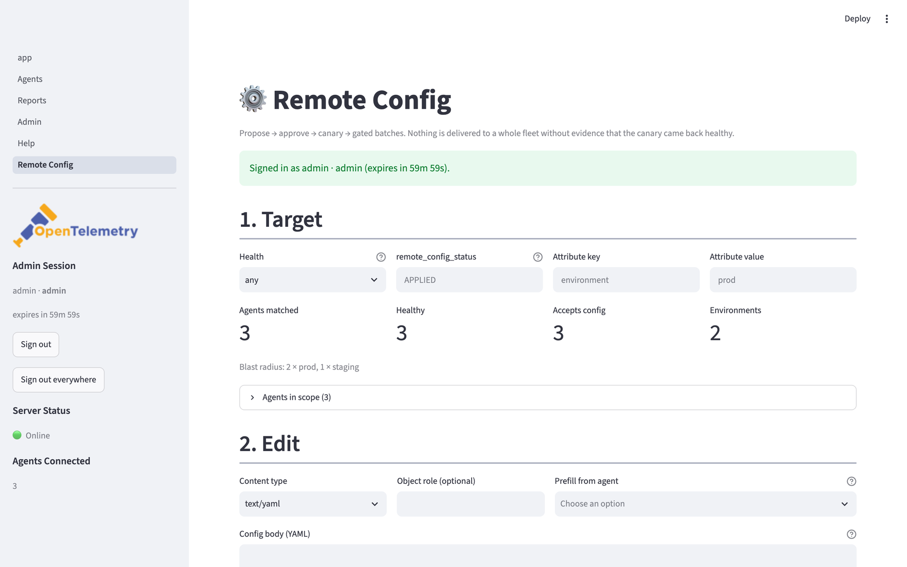
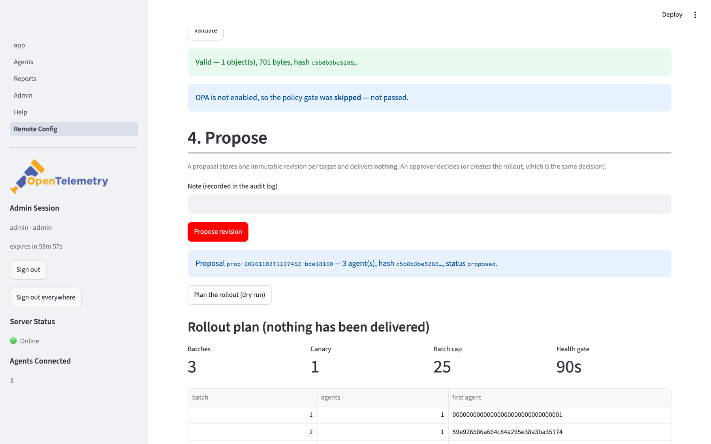
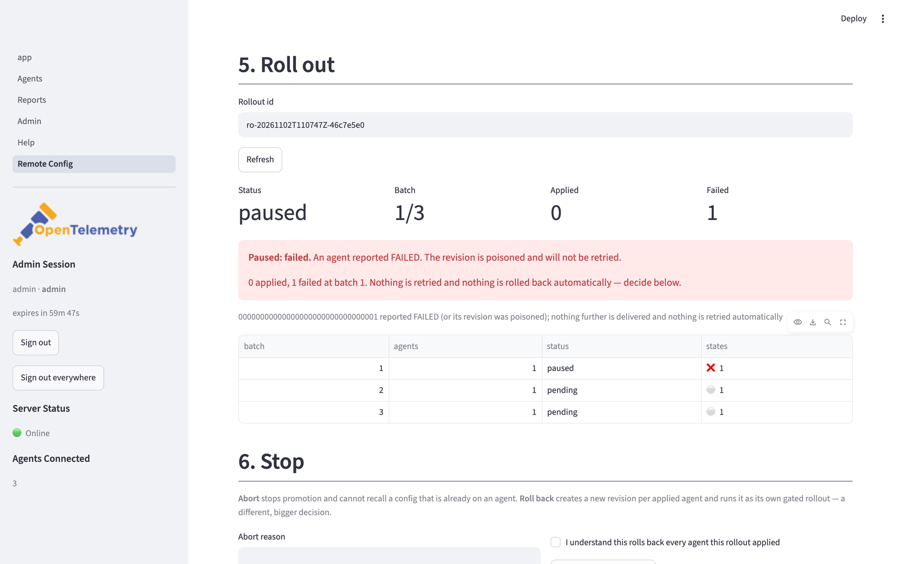

# OpAMP Server


OpenTelemetry OpAMP server in Python with FastAPI + Streamlit UI. Optional integration with [Open Policy Agent](https://www.openpolicyagent.org).

This server also lets you:

- Filter collectors by metadata (such as `environment: production`) or by **SQL** (`SELECT * FROM agents WHERE host_arch = 'amd64'`) — see [`docs/sql-agent-queries.md`](docs/sql-agent-queries.md)
- Build minimal OTel Collectors (server generates a new `manifest.yaml` which you build with the [OpenTelemetry Collector Builder [OCB]](https://github.com/open-telemetry/opentelemetry-collector/tree/main/cmd/builder))
- Validate connected collectors against OPA compliance policies
- Be driven by **AI agents** — a REST API with a self-documenting OpenAPI schema, an `opampctl` CLI with JSON output, a shared `opamp_client` Python library, and an MCP server with typed tools

Want to learn more about OpAMP? [Read the spec](https://opentelemetry.io/docs/specs/opamp/).

## Architecture

```
┌─────────────────────────┐        ┌─────────────────┐        ┌──────────────┐
│  OTel Collector         │───────▶│  OpAMP Server   │────────│  UI (:8501)  │
│  (OpAMP Extension)      │        │  (:4320)        │        └──────────────┘
└─────────────────────────┘        └─────────────────┘        ┌──────────────┐
                                           │                  │ opampctl CLI │
                                  ┌────────┴──────────────┐   │ MCP server   │
                                  │   Open Policy Agent   │   └──────────────┘
                                  │  (:8181)              │
                                  └───────────────────────┘
```

## Protocol definitions (`proto/`)

The wire format lives in [`proto/opamp.proto`](proto/opamp.proto) and
[`proto/anyvalue.proto`](proto/anyvalue.proto), synced to
[opamp-spec **v0.20.0**](https://github.com/open-telemetry/opamp-spec/tree/v0.20.0/proto/opamp/v1).
The Python stubs (`proto/*_pb2.py`, `proto/*_pb2.pyi`) are generated and committed.

Two deliberate differences from upstream:

- **Flat layout.** Files stay in `proto/` rather than `proto/opamp/v1/`, so `opamp.proto`
  imports `"proto/anyvalue.proto"` instead of `"opamp/v1/anyvalue.proto"`. That is what
  makes the stubs import each other as `from proto import anyvalue_pb2` and every call
  site (`server/`, `cli/`, `tests/`) keep using the `proto.opamp_pb2` path. Nothing on the
  wire changes: protobuf does not transmit package, file or message names.
- **Generated with protoc 34.1**, so the stubs refuse to import on a protobuf runtime older
  than 7.34.1 (`requirements.txt` pins that floor). Regenerating with a newer protoc
  raises the floor — bump the requirement in the same commit.

Regenerate after editing a `.proto`:

```bash
./scripts/generate_proto.sh      # prints the expected protoc release if it is missing
git diff --stat -- proto/        # a clean tree means the stubs were not stale
python -m pytest tests/test_proto_sync.py
```

`tests/test_proto_sync.py` is the guard rail: it pins the proto package, every
pre-existing field number, the byte-for-byte encoding of a pre-v0.20.0 message, and the
messages v0.20.0 added (`AgentConfigObject.role`, `ComponentHealth.attributes`). A
renumbered field is invisible in review — protobuf happily parses the old bytes into the
new field — so the test is the only thing that catches it.

## Quick Start

### Docker Compose (Recommended)

Pre-built images are available from GitHub Container Registry:
- `ghcr.io/agardnerit/opamp-server-py-server:0.0.6`
- `ghcr.io/agardnerit/opamp-server-py-ui:0.0.6`

Images are multi-arch (`linux/amd64`, `linux/arm64`). Pushing a `vX.Y.Z` git tag
publishes `X.Y.Z` and `X.Y`, and moves `latest`; a prerelease tag such as
`vX.Y.Z-rc1` publishes only `X.Y.Z-rc1` and leaves `latest` alone. Tags are
created with `python3 release.py --version vX.Y.Z`.

```bash
# Start server and UI
docker-compose up -d

# With OPA for compliance checking
docker-compose --profile opa up -d

# View logs
docker-compose logs -f
```

Access:
- UI: http://localhost:8501
- Server: http://localhost:4320
- OPA (if enabled): http://localhost:8181

Configuration lives in `.env` — that is the only place you edit. Copy `.env.sample`
to get one with every setting commented, including its default and what it does. Both
services pass the whole file into the container (`env_file`), so a variable you add
there reaches the app whether or not `docker-compose.yml` mentions it.

`docker-compose.yml` pins only what a container cannot read from `.env`: where the UI
keeps its scratch database, and that it reaches the server as the `server` service
rather than `localhost`. Those two are commented as overrides where they appear.
Everything else in the compose file is a fallback spelled `${KEY:-default}`, so a
value in `.env` always wins and there is no second copy of the configuration to drift.

With no `.env` at all the stack still starts: read-only for writes, config push off,
and a random admin password generated on first boot (`required: false` keeps that a
supported posture rather than a boot error). The app's built-in defaults are already
the secure ones, so the missing file changes nothing about the posture.

There is no default admin password. On first start the server generates a random
one, prints it once in the logs (`docker compose logs server | grep -i "admin
password"`), and stores it at `$DATA_DIR/admin_password` (mode 0600) — inside the
`opamp-data` volume, not `./data`, because SQLite may not live on a macOS bind
mount (see [If every write answers 503](#if-every-write-answers-503)). Read it out
with `docker compose cp server:/app/data/admin_password .`. Set `ADMIN_PASSWORD` in
`.env` to choose your own. Both ports bind to `127.0.0.1` on purpose — see [Before
you expose this server](#before-you-expose-this-server).

### Developing with Docker (local source, hot reload)

`docker-compose.yml` references **published images** (`ghcr.io/…:0.0.6`). Those
services have no `build:` section, so `docker compose up --build` has nothing to
build — Compose pulls the pinned image again and your local changes never reach the
container. That is also why the sidebar keeps showing the old version: the version is
`server/version.py` (kept in sync with `pyproject.toml` by `tests/test_version.py`),
not a build stamp, so `0.1.0` means "this checkout has not bumped the version", not
"the image is stale".

Use the development overlay, which builds the local Dockerfiles and bind-mounts the
source with autoreload:

```bash
# One command, every time during development
docker compose -f docker-compose.yml -f docker-compose.dev.yml up --build

# If you want plain `docker compose up` to use the overlay for this shell:
export COMPOSE_FILE=docker-compose.yml:docker-compose.dev.yml
docker compose up --build
```

The overlay tags the local builds `opamp-server-py-server:dev` and
`opamp-server-py-ui:dev`, so it does not overwrite the pinned release images. It
also:

- bind-mounts `server/`, `proto/`, `policies/`, `collector/`, `ui/` and `.streamlit/`
  into the containers, so **editing an existing file hot-reloads** (uvicorn
  `--reload` for the server, Streamlit `runOnSave` + polling for the UI);
- keeps the `opamp-data` named volume at `/app/data`, so the database is not reset by
  a rebuild.

Things that still need a container restart rather than a hot reload:

- **A new Streamlit page file** (e.g. `ui/pages/3_Groups.py`): Streamlit reloads
  changed modules, but it does not notice a page that no running script has imported
  yet. Run `docker compose -f docker-compose.yml -f docker-compose.dev.yml restart ui`
  once after adding one.
- **Dependency or Dockerfile changes** (`requirements*.txt`, `Dockerfile.*`): rebuild
  with `--build` (no need for `--no-cache` unless the base image itself changed).
- **New Python packages** must be added to `requirements.txt` / `requirements-ui.txt`
  and rebuilt; the bind mount only shadows source files.

Verify the new surface is live:

```bash
curl --max-time 20 --connect-timeout 5 -s localhost:4320/openapi.json | grep -o '"/agents/query/schema"'
docker compose -f docker-compose.yml -f docker-compose.dev.yml logs -f ui
```

The sidebar should now show **Groups**. `docker compose down` is not needed between
code changes; `up -d --build` recreates only what changed. Avoid `down -v` unless you
intend to delete the `opamp-data` volume (database and generated admin password).

### Manual Setup

#### Server
```bash
python -m venv ./venv
source venv/bin/activate
pip install -r requirements.txt
uvicorn server.main:app --port 4320
```

#### UI
```bash
pip install -r requirements-ui.txt
streamlit run ui/app.py
```

#### CLI + MCP server (for humans and AI agents)

```bash
pip install -e .            # installs opampctl + opamp-mcp entry points
opampctl health             # → {"status": "healthy", ...}
```

For MCP tools (used by Claude Desktop, Claude Code, and other MCP clients):

```bash
pip install -e ".[mcp]"     # adds the mcp dependency
```

### Connect a collector

This server works with **any collector distro that ships
`extension/opampextension`** — `otelcol-contrib`, a core build with the extension
compiled in, a supervisor-managed collector, or a custom distro. Nothing has to be
rebuilt to connect one: adding the block below is the whole integration.

That is a hard product rule, not an accident of the current code: **using this
server must never require a proprietary or bespoke collector build.** Everything
here is Apache-2.0 (see [LICENSE](LICENSE)), every component it talks to is
upstream OpenTelemetry, and a stock `otelcol-contrib` is always supported. If a
capability ever needs a component that upstream does not have, it will be published
under an OSS license together with a written explanation of why it is needed —
none is required today.

`collector/e2e.yaml` is the known-good config that CI runs against a real
`otelcol-contrib` on every PR (`.github/workflows/collector-e2e.yml`, #113).

**HTTP transport** — add the extension and name it in `service.extensions`:

```yaml
extensions:
  opamp:
    server:
      http:
        endpoint: http://127.0.0.1:4320/v1/opamp
        polling_interval: 5s
    agent_description:
      non_identifying_attributes:
        "agent.name": "collector-1"      # your label; `GET /agents` shows it
        "environment": "production"

service:
  extensions: [opamp]                     # required, or the extension never starts
  pipelines:
    traces:
      receivers: [otlp]
      processors: [batch]
      exporters: [debug]
```

Restart the collector, then check it arrived:

```bash
curl --max-time 20 --connect-timeout 5 -s localhost:4320/agents | jq '.count, .agents[].id'
opampctl agents list --pretty            # same data with names and capability tags
```

**WebSocket transport** — replace the `http` block with `ws`. One block, not
both: the extension uses whichever is present. The server accepts the upgrade by
default; set `OPAMP_WS_ENABLED=false` to refuse it.

```yaml
extensions:
  opamp:
    server:
      ws:
        endpoint: ws://127.0.0.1:4320/v1/opamp
```

`server.ws` takes `endpoint` and `headers` only — `polling_interval` is an HTTP
concept and is **rejected** as an unknown key (verified against `0.140.0`). A
socket is server-push, so there is nothing to poll; the agent still sends its own
heartbeats. Both transports carry the identical message handler, so the state in
`/agents` is the same either way (`tests/test_ws_parity.py` asserts it).

**Agent token** (required by default) — the credential rides in a header, because
that is what `opampextension` supports:

```yaml
extensions:
  opamp:
    server:
      http:                               # or `ws:`, with the same headers block
        endpoint: http://127.0.0.1:4320/v1/opamp
        headers:
          Authorization: "Bearer ${env:OPAMP_AGENT_TOKEN}"
```

Mint it with `opampctl agent-tokens create --expires-in-days 30 --max-agents 50`
(one token, many agents, no `instance_uid` needed first) or, for a single known
agent, `opampctl agents token create <agent-id>`. The response carries a paste-ready
snippet. Keep the token out of git by passing it as an environment variable:
`${env:…}` is expanded by the collector and the value is `configopaque`, so the
agent's own effective-config report redacts it. See [Agent tokens](#agent-tokens-agent--server)
and the [first-run runbook](#first-run-nothing-to-migrate).

The UI's connect snippet (Help page and the Agents empty state) is not hardcoded: it
reads `config_push.agent_auth` from `GET /health` and renders the `headers:` block
whenever the server reports `token`, so copy-paste cannot hand you a config that
401s. When it cannot read the mode it claims no credential and says so (#124).

**TLS** — terminate it in front of the server rather than in it: set
`TLS_TERMINATED_UPSTREAM=true` (this asserts the posture; see
[Before you expose this server](#before-you-expose-this-server)), keep port 4320
bound to loopback, and point agents at the proxy:

```yaml
        endpoint: https://opamp.example.com/v1/opamp    # ws → wss://
```

`docker/nginx.conf` and `docker/Caddyfile` are ready-made terminators; forward
`Upgrade`/`Connection` and a long read timeout so the WebSocket transport keeps
working, and leave `Origin` intact.

**Polling interval** — for HTTP this *is* the heartbeat. The server learns each
agent's cadence and scales its staleness timeout to it, so a 60 s poller is fine;
what it cannot tell apart is "slow poller" and "died on startup" before the second
report, so a very long interval widens the window in which a restart looks like a
new agent. 5–30 s is a good range.

**Verifying it worked.** `/agents` shows the agent, its description attributes and
its health. `GET /agent/{id}` shows the detail worth checking on day one:
`available_components` present in full (the server asks once per hash, #77),
`components` with the parts actually used by the pipeline, and `capabilities`
telling you which optional features the agent will accept. `GET /health` reports
`spec_version` and the server's own capability bits, so "will this agent
interoperate?" is answerable without reading source.

| Distro | Works? | Note |
|---|---|---|
| `otelcol-contrib` | ✅ | The e2e config in this repo, [verified in CI](.github/workflows/collector-e2e.yml) |
| Custom/core build | ✅ | Only if it includes `extension/opampextension` |
| `otelcol` (core, upstream) | ❌ | No `opamp` extension in the core distro — use contrib or a build that has it |
| OpAMP Supervisor | ✅ | Different config shape; it can also consume connection settings (the collector extension cannot) |

A **slim distro built with OCB** is an optional optimisation, not a requirement:
`POST /agent/{id}/manifest` (and the UI) generates a manifest for exactly the
components an agent uses, if you want to ship a smaller binary. Any distro works
without it.

### Transports

Plain HTTP is the default and is what the collector's `opamp` extension uses
(`endpoint: http://host:4320/v1/opamp`). The same path also accepts a WebSocket
upgrade, which it does by default: an HTTP-only client never sends one, so the
default costs it nothing, and a WebSocket client needs no server-side setup.
`OPAMP_WS_ENABLED=false` refuses the upgrade with `1008`. Frames are a base-128
varint header (must be
`0`) followed by the protobuf message; messages over `OPAMP_MAX_MESSAGE_BYTES`
close the socket with `1009`. Both transports run the same message handler, so
agent state is identical either way.

WebSocket upgrades are not covered by `CORSMiddleware`, so the handshake checks
`Origin` itself: agents (which send no `Origin`) always pass, and a browser origin
must be listed in `CORS_ORIGINS` unless that is `*`. If you launch uvicorn
directly, set `--ws-max-size` to at least `OPAMP_MAX_MESSAGE_BYTES` or uvicorn's
16 MiB default will close frames before the app limit applies.

Both transports enforce `OPAMP_MAX_MESSAGE_BYTES` (64 MiB by default). On HTTP the
limit is checked against `Content-Length` first and then while streaming, **after**
`Content-Encoding: gzip` decompression — so a small compressed body cannot expand
past the cap. An oversized body gets `413 Content Too Large` and changes no state
(no registration, no heartbeat, no metrics). A body that is not a usable
`AgentToServer` — unparseable protobuf, an empty `instance_uid`, or corrupt gzip —
gets `400` with a `ServerToAgent.error_response` (`type: BAD_REQUEST`) and a
human-readable reason; a `Content-Encoding` the server does not implement gets
`415` with the same body. `/v1/metrics` carries OTLP, not OpAMP, and deliberately
does not share this limit. On WebSocket the same rejections send the error frame and
close `1002`; oversized frames close `1009`.

#### Compression

Agents may gzip their request body (`Content-Encoding: gzip` or `x-gzip`) and the
server unrolls it *inside* the bounded read, so a decompression bomb is refused at
the limit rather than expanded first. The reply is gzipped when the agent sent
`Accept-Encoding: gzip` **and** the body is at least 1 KiB — a 40-byte capabilities
reply costs more to compress than it saves, so it stays plain. `Vary:
Accept-Encoding` is set so a cache cannot serve gzip to a client that cannot read it.
The collector's `opamp` extension does not enable compression today; `opamp-go`
clients that call `EnableCompression()` get it for free.

#### Incomplete status reports

Agents may omit unchanged sub-messages, so an `AgentToServer` is not necessarily a
full picture. The only signal the spec provides is `sequence_num`: anything that is
not exactly one greater than the last accepted value means status was missed, and
the server answers with `ReportFullState` so the agent resends everything. Three
details are worth knowing:

- the counter is persisted per agent (`GET /agent/{id}` → `last_sequence_num`) so it
  survives a server restart, which is the case the spec's rule exists for;
- `sequence_num: 0` means "not set" and never triggers an ask, so an SDK that never
  fills the field is not asked for full state on every message;
- the ask is rate limited per agent to `REPORT_FULL_STATE_MIN_INTERVAL_SECONDS`
  (60), because a flapping agent with a broken counter would otherwise turn every
  poll into a full-state request. Counted in
  `opamp_full_state_requested_total{reason}` — `new_agent` for the registration
  baseline, `sequence_gap` for a repair.

#### Hash-only component lists

The spec also lets an agent send only the `hash` of its `AvailableComponents` unless
the server asked for the details with `ReportAvailableComponents`. An agent that does
this is compliant but useless for the manifest feature: `POST /agent/{id}/manifest`,
the component report and the heavy/outdated collector reports all have nothing to work
with. So the server asks — carefully (#77):

- the ask is **one-shot per hash**: a hash-only report makes the next reply set
  `ReportAvailableComponents`, and the same hash is never asked about again. An agent
  that keeps sending it is not in a request loop it cannot leave;
- a **changed hash** (agent upgraded, pipeline edited) earns exactly one new ask;
- the hash we asked about is persisted (`GET /agent/{id}` →
  `last_requested_components_hash`), so a restart does not repeat the ask;
- an agent that ignores the ask is counted (once, at the third hash-only report for
  that hash, then the counter saturates so the steady state stays write-free) and
  logged at `WARNING` — otherwise "this SDK never implements the flag" is invisible.
  `GET /agent/{id}` exposes it as `components_request_ignored`;
- the #70 and #77 asks are independent: one reply may carry `ReportFullState` **and**
  `ReportAvailableComponents`.

Counted in `opamp_available_components_requested_total{reason}` (`hash_only` for the
first ask, `hash_changed` after the list moved) and
`opamp_available_components_ignored_total`.

### The Remote Config page (UI)

Streamlit page **Remote Config** (`ui/pages/5_Remote_Config.py`) implements the whole
flow, in the epic's order and with review between every step: **Target** (filters, live
count, blast-radius breakdown) → **Edit** (with prefill from an agent's effective config,
and a hard refusal of redacted bodies) → **Validate** (YAML paths, warnings, policy gate)
→ **Propose** (a draft that delivers nothing) → **Plan** (the rollout's real batches and
caps, from the dry run) → **Approve & roll out** (approver: canary released, the rest
held) → **live progress** (per-batch and per-agent state, pause reason, gate countdown)
→ **Stop** (abort vs rollback, visibly different) → **History** (rollouts and revisions,
with who approved what).

It is a session-token client (#105): buttons are role-gated in the page *and* the server
re-authorises every call, so the UI is ergonomics and never the boundary. Config bodies
are never listed; the per-agent reveal stays on the Agents page where it is audited.



*Step 1 — the fleet is counted and broken down by environment before anything is edited.*



*The plan is the review screen: real batches, canary size, caps and the health gate. The
button below it is the only way a rollout starts.*



*A paused rollout names its one reason and shows which batch failed; abort and rollback are
separate, differently-gated actions below.*

### OpAMP specification and capability matrix

This server targets **OpAMP [v0.20.0](https://github.com/open-telemetry/opamp-spec/releases/tag/v0.20.0)**
— the generated stubs in `proto/` are built from that release (#66). `GET /health`
returns `spec_version` and the exact server `capabilities` bitmask, so `opampctl`, the
MCP server and the UI never hardcode either.

Transports: **HTTP** (poll/reply) and **WebSocket** (`OPAMP_WS_ENABLED`, upgrade on
`/v1/opamp`, #89, on by default) — same framing, same message handler, same auth.

| Direction | Capability | Status |
|---|---|---|
| Server | `AcceptsStatus` | ✅ always advertised |
| Server | `AcceptsEffectiveConfig` | ✅ always advertised (stored, redacted on read) |
| Server | `AcceptsPackagesStatus` | ✅ always advertised (stored/reported only) |
| Server | `OffersRemoteConfig` | ✅ advertised while the posture allows push (#81, #96) |
| Server | `OffersPackages` | ❌ [#82](https://github.com/agardnerIT/opamp-server-py/issues/82) closed as not planned — no stock agent consumes it and shipping binaries is deploy tooling's job (see [spec conformance](docs/spec-conformance.md)). We ship the OCB manifest instead |
| Server | `OffersConnectionSettings` | ❌ [#83](https://github.com/agardnerIT/opamp-server-py/issues/83) |
| Server | `AcceptsConnectionSettingsRequest` | ❌ [#83](https://github.com/agardnerIT/opamp-server-py/issues/83) |
| Agent | `ReportsStatus`, `ReportsHealth`, `ReportsEffectiveConfig` | ✅ understood (health is optional; its absence is not unhealth) |
| Agent | `ReportsAvailableComponents` | ✅ understood (drives validation warnings) |
| Agent | `ReportsPackageStatuses` | ⚠️ stored and displayed, not acted on |
| Agent | `AcceptsRemoteConfig` | ✅ required before a config is offered (`remote_config.decision_for`) |
| Agent | `AcceptsRestartCommand` | ✅ [#84](https://github.com/agardnerIT/opamp-server-py/issues/84) — `POST /agent/{id}/restart`; 409 without the bit |
| Agent | custom capabilities / messages | ✅ [#85](https://github.com/agardnerIT/opamp-server-py/issues/85) — list stored and shown; `POST /agent/{id}/custom-message` delivers one, exactly once |

The classification lives in `server/remote_config.py`
(`ALWAYS_ADVERTISED` / `CONDITIONAL` / `UNIMPLEMENTED` / `RESERVED`), and
`tests/test_capabilities.py` fails when a proto bump adds a capability none of them
mentions: silently dropping a bit is a symptom, an unclassified bit is what
over-claims to every agent. `GET /health` publishes the same values, so "will my agent
interoperate?" is answered without reading the source (#79).

The same question, clause by clause — including what is **deliberately** different from
the spec and why — is **[`docs/spec-conformance.md`](docs/spec-conformance.md)**, next
to the machine-checked spec index in `tests/conformance/` (#80). That pair is what a
spec bump should be reviewed against.

Both transports accept credential headers, which is what makes per-agent
authentication possible without a wire extension: `extension/opampextension` supports
`server.http.headers` **and** `server.ws.headers` (verified against v0.140.0 — the
values are `configopaque`, so the agent's own effective-config report redacts them),
and `opamp-go` sends them on every HTTP request and on the WebSocket upgrade. The
supervisor supports the same `headers` block.

## Agent tokens (agent → server)

Agents authenticate with `Authorization: Bearer <token>`; the server refuses a
connection without one. `OPAMP_AGENT_AUTH` is the switch, and **it defaults to
`token`** — a tokenless OpAMP endpoint believes whatever `instance_uid` the message
body claims, so being open is a decision rather than the thing you get by not
deciding:

| Setting | Behaviour |
|---|---|
| *(unset)* | `token`: agents must present a token, or they get 401 / 1008 |
| `token` | Same, stated explicitly |
| `off` | Unauthenticated, as before #126: any client that can reach the port can claim any agent identity. Logs a startup warning |
| `OPAMP_ALLOW_UNAUTHENTICATED_AGENTS=true` | The other way to reach `off`, for tooling that sets nothing. Reported in `/health` as `config_push.agent_auth_override` and shown as a banner in the UI |
| `mtls` | Reported by the posture but **not enforced by this build** — certificates are terminated by your proxy, so the server would only be trusting a forgeable header. Use `token`; mTLS arrives with the CA work in #83 |

An unrecognised value keeps authentication **on** and warns: a typo must not open
the endpoint.

### Two kinds of token

| Kind | Mint | What it is | Use when |
|---|---|---|---|
| **fleet** | `POST /agent-tokens` (`opampctl agent-tokens create`) | Access, up to `max_agents` agents. Each agent's `instance_uid` stays its identity | Onboarding a fleet — including a fleet that does not exist yet, because nothing has to be registered first |
| **bound** | `POST /agents/{id}/token` (`opampctl agents token create <id>`) | The credential **is** that one agent's identity; another uid is refused | Pinning a credential to an agent you already know |

The fleet token is the default path, and the reason is bootstrap: a bound token
needs an `instance_uid`, and an agent only reveals that by connecting — so a fresh
install could never mint the credential it needs to let the first agent in.

Tokens carry two limits, both optional and both enforced on every message:

- **`expires_in_days`** — 1, 7 or 30 (or any 1–365), or `null` for never. An expired
  token is refused `expired`.
- **`max_agents`** — the cap. The agent that would exceed it is refused
  `agent_limit`, with a line in the server log, and its state is never touched. A
  leaked token therefore cannot consume the server, and the count is of *distinct
  agents*, so re-polling does not eat slots. Slots are never released — a token that
  could recycle uids forever would defeat the cap; mint a new token when you need room.

With a token, in either kind:

- a missing, unknown, revoked or expired token gets **401** (HTTP) or **1008**
  (WebSocket) with **no** `ServerToAgent` body — an unauthenticated client learns
  nothing, not even which capabilities exist;
- a **bound** token claiming a *different* `instance_uid` gets **403** / 1008,
  rejected before any state is applied, so the real agent's record is untouched;
- every rejection is counted in `opamp_agent_auth_failures_total{reason}` —
  `missing`, `malformed`, `unknown`, `revoked`, `expired`, `agent_limit`,
  `uid_mismatch`, `binding_conflict` — and written to the [audit log](#audit-log);
- a live WebSocket binding may only move to the **same credential**, so a second
  token cannot take over an agent (a legitimate reconnect moves cleanly, and two
  agents sharing one fleet token do not fight over the socket map).

Tokens are `opamp_agent_…`, stored as SHA-256 only, and returned exactly once at
creation. They never appear in `/agents`, logs, audit entries or error bodies —
listings and audit entries use the `token_id` (`agtok_…`) handle instead.
`GET /agents` and `GET /agent/{id}` report each agent's credential state as
`{"enrolled", "active", "last_seen_at", "revoked_at", "tokens"}` so you can watch a
cutover and answer "which token let this agent in".

### First run (nothing to migrate)

```bash
# 1. Mint a token for the fleet — no agent has to exist yet
opampctl --password "$ADMIN_PASSWORD" agent-tokens create \
    --label prod --expires-in-days 30 --max-agents 50
#    -> {"token": "opamp_agent_...", "token_id": "agtok_...", "collector_snippet": ...}

# 2. Put the headers block in each agent's config (the response carries it ready to
#    paste) and reload the collector:
#      extensions.opamp.server.http.headers:
#        Authorization: "Bearer opamp_agent_..."
#    (server.ws.headers instead, if that agent speaks WebSocket). On an empty fleet the
#    UI's Agents page does steps 1 and 2 for you.

# 3. Watch them arrive, and watch the cap
opampctl agents list --pretty
opampctl agent-tokens list            # agents_used / max_agents, expires_at
```

### Upgrading a fleet that is still `off`

`OPAMP_AGENT_AUTH` now defaults to `token` (#126). An existing deployment that
relied on the old default starts answering 401, so pick one path *before*
upgrading:

```bash
# A. Stay open for now — the old behaviour, named out loud:
OPAMP_ALLOW_UNAUTHENTICATED_AGENTS=true

# B. Close it with no per-agent work: mint ONE fleet token, deploy it everywhere
opampctl --password "$ADMIN_PASSWORD" agent-tokens create --label prod --max-agents 500
#    ...then restart the server without the override.
```

Path B is the point of the fleet token: the old runbook needed a token per agent,
minted only after that agent had registered. Watch for stragglers with
`curl --max-time 20 --connect-timeout 5 -s localhost:4320/metrics | grep opamp_agent_auth_failures_total` — the
`reason` label distinguishes a config that has not reloaded (`missing`) from a
token problem (`unknown`/`revoked`/`expired`/`agent_limit`).

Rotation needs no downtime: mint a new token, deploy it, and revoke the old one
once `agents_used` on the new one has caught up. Revocation
(`opampctl agent-tokens revoke <agtok_…>`, or `agents token revoke <id>` for a
bound one) blocks delivery but **keeps** the agent's record, state and desired
config — revocation is not a wipe, deliberately: you need that config to restore
the agent later.

An agent with a revoked or broken credential retries forever with backoff, because
opamp-go cannot tell 401 from 403 — watch the failure metric, not the agent log.

Why the token lives in the config file instead of being handed down the wire:
`extension/opampextension` registers no `OnOpampConnectionSettings` callback, so
an in-band "here is your token" reply is ignored. The supervisor can consume
connection settings; the collector extension cannot. Registration-on-first-use
and CSR/TOFU stay in #83.

## Update checks (#46)

Once per 24 h the server asks GitHub for the latest release. The UI shows the
current version, a banner when a newer one exists, and copyable upgrade commands.
Nothing is ever upgraded automatically.

- **On by default.** `UPDATE_CHECK=off` disables it for the deployment and wins
  over the admin toggle. Off is not recommended: you may miss security fixes.
- **Updates** (Admin section) has the toggle, "Check now", and "Use deployment default".
  The admin override is stored in `data/update-settings.json`; the deployer's
  `off` always wins.
- **The request is anonymous.** One `GET` to GitHub's releases API, with no
  current version, instance ID, hostname, fleet data, cookies, `.netrc`, or
  proxy environment. The comparison is local. `UPDATE_HTTP_PROXY` is the only
  explicit proxy hook.
- `GET /updates` is a cached read and never performs network I/O.
  `POST /updates/check` is admin-only and rate-limited to one check a minute.
- `opampctl updates status|check|enable|disable|default`; MCP tools
  `get_update_status`, `check_for_updates`, and (with writes enabled)
  `set_update_check`.

## Release emails (optional)

The **Release emails** page can show a signup box for project release
announcements. It is an
iframe to a Cloudflare Worker; the address goes browser → Worker → the project's
Resend segment. This server never receives or stores it, and the Worker has no
endpoint to list subscribers.

The project's Worker URL is the default, so the box appears without any
configuration. Set `UPDATE_SUBSCRIBE_URL` to a different URL to use your own
Worker, or to `off` to hide the box:

```bash
UPDATE_SUBSCRIBE_URL=off
```

Double opt-in is mandatory: nothing is added to Resend until the recipient clicks
the confirmation link. Every broadcast carries Resend's unsubscribe link. The
Worker's setup, data retention and tests are in
[`cloudflare/updates-worker/README.md`](cloudflare/updates-worker/README.md).

If the variable is empty the box is hidden.

## Before you expose this server

This server ships **read-only by default** and is meant to be reachable by
trusted agents on a trusted network until you finish the checklist below.
Plain HTTP + no admin credential + agents that claim any `instance_uid` + a port
published to the world is a fleet takeover, so the defaults are now closed:

| Thing | Default | What that means |
|---|---|---|
| `ADMIN_PASSWORD` | *none* | Read-only mode: reads are open, **every privileged write answers 403** (#95). Prefer named principals with roles — see [Roles](#roles). Docker generates a random password on first start and stores it in `data/admin_password`; nothing ships a placeholder |
| Config push | **off** | Push routes return 404 (not 403 — a stranger does not get to learn the surface exists), the server does not advertise `OffersRemoteConfig`, and no `remote_config` field is ever sent |
| Agent tokens | **required** | A tokenless agent gets 401. Mint one with `opampctl agent-tokens create` and put it in the agent's config — see [Agent tokens](#agent-tokens-agent--server). `OPAMP_ALLOW_UNAUTHENTICATED_AGENTS=true` is the deliberate opt-out, and it is reported everywhere |
| TLS | off | Credentials and configs travel in cleartext |
| Config at rest | *no key* | Config bodies are not stored until `CONFIG_AT_REST_KEY` is set (or the plaintext opt-out is taken) — see [Config data and secrets](#config-data-and-secrets) |
| Ports in `docker-compose.yml` | `127.0.0.1` | Reachable from the host only, not from the network — the UI (`:8501`) included: it is a server-side admin console with a live session token and no TLS of its own |

**To expose it safely**, do all five:

1. **Put TLS in front.** Use `docker/nginx.conf` or `docker/Caddyfile`, then set
   `PUBLIC_URL=https://opamp.example.com` (or `TLS_TERMINATED_UPSTREAM=true`).
   Keep port 4320 bound to loopback so nothing can bypass the proxy, forward
   `Upgrade`/`Connection` and a long read timeout for the WebSocket transport,
   and leave `Origin` intact — `CORSMiddleware` does not apply to upgrades, so
   the server's own check is the only one.
2. **Give each person an identity** (`opampctl auth principals create … --role admin|approver|operator|viewer`) — the
   generated `data/admin_password` is a bootstrap credential, not a way to run a team:
   with one shared secret there is no `approver` distinct from `operator`, and no way
   to revoke one person without logging everyone out.
3. **Authenticate your agents** (`OPAMP_AGENT_AUTH=token`) and mint a credential
   per agent. The token travels in the agent's config, so TLS is not optional
   once you turn this on.
4. **Set `CORS_ORIGINS`** to the origin the UI is served from instead of `*`.
5. **Set `CONFIG_AT_REST_KEY`** so pushed configs are encrypted on disk. Losing
   the key loses *desired* config, not the fleet — see
   [Config data and secrets](#config-data-and-secrets).
6. **Keep config push off** until the posture check passes for you. Turning it on
   is refused at startup unless admin auth, agent auth, TLS, a writable audit log
   and a config encryption key are all in place:

```bash
OPAMP_CONFIG_PUSH_ENABLED=true uvicorn server.main:app --port 4320
# refusing to start: OPAMP_CONFIG_PUSH_ENABLED=true but the server posture is insecure:
#   - admin auth is not configured: ...
#   - agents are not authenticated: ...
#   - the server is not served over TLS: ...
#   - the audit log is not available: ...
#   - config bodies would be stored unencrypted: ...
```

The only way past that is `OPAMP_ALLOW_INSECURE_CONFIG_PUSH=true`, which is for
local development: it logs a red warning, reports `insecure: true` in `/health`,
and puts a permanent banner on every UI page. It is deliberately unpleasant.

Check your posture at any time:

```bash
curl -s localhost:4320/health | jq .config_push
# {"enabled": false, "insecure": false, "agent_auth": "off", "audit": true, "tls": false,
#  "config_at_rest": "unconfigured"}
opampctl --password "$ADMIN_PASSWORD" health   # same, plus config_push
curl -s -u ":$ADMIN_PASSWORD" localhost:4320/config/posture | jq .requirements
```

## Audit log

Every privileged decision — a login, a lockout, a session revoked, a principal
created, an agent credential minted or revoked, an agent auth failure — writes
exactly one row to `audit_log` in `data/opamp.db`. From #99 onward, every
config-push action lands there too, so "who pushed that config to 400 collectors"
has an answer that does not depend on anyone remembering.

```bash
opampctl --password "$ADMIN_PASSWORD" audit list --action config. --limit 20
opampctl --password "$ADMIN_PASSWORD" audit list --actor alice --since 2026-10-01
opampctl --password "$ADMIN_PASSWORD" audit verify            # exit 1 if the chain is broken
opampctl --password "$ADMIN_PASSWORD" audit export -f jsonl -o audit.jsonl
```

**Hash-chained.** Each row stores `prev_hash` (the previous row's `entry_hash`) and
an `entry_hash` over its own canonical JSON. `GET /audit/verify` recomputes the
whole chain: an edited row fails an `entry_hash` check, a deleted or reordered row
fails a `prev_hash` check, and `broken_at` names where it shows. Be honest about
the limits — an attacker with write access to the database can rebuild the chain
from the start, so export entries off-box (`audit export`) if the log is evidence.

**Fail closed.** A privileged action records its decision *before* acting, and if
the row cannot be written the action does not happen (HTTP 500, nothing mutated).
Denials and auth failures are the exception: those are logged best-effort, because
turning a 401 into a 500 when the disk is full is an outage caused by bookkeeping.
After 5 consecutive write failures the best-effort path pauses for 60s — `AUDIT`
lines in the server log keep flowing, and `/health` reports `audit: false`.

**No bodies, no secrets.** Entries carry actor, role, action, target, result and a
small redacted `detail_json` — hashes, counts, verdict codes. Fields named like
credentials are dropped at the seam, so passing a token by accident cannot store
it. Config *bodies* never appear; `config_hash` does (that is the #99 seam).

**Retention.** `AUDIT_RETENTION_DAYS` (default 365; `0` keeps forever) prunes at
most hourly. A prune writes an `audit.checkpoint` row recording the hash it cut to
before deleting, so `/audit/verify` anchors there instead of reporting a permanent
break; deleting rows *before* the checkpoint still shows up as tampering.

| Result | Means |
|---|---|
| `ok` | the action was performed |
| `denied` | refused before acting (bad credential, insufficient role, locked out) |
| `error` | recorded, then the mutation failed (see the second row for the outcome) |
| `noop` | idempotent no-change (e.g. logging out twice) |

## Config objects (#68)

`EffectiveConfig.config_map` holds **configuration objects**, and their keys are
agent-implementation-defined: `""` is valid and has no privileged meaning
([spec v0.20.0 §Configuration Objects](https://github.com/open-telemetry/opamp-spec/blob/v0.20.0/specification.md)).
`otelcol-contrib` with `reports_raw_config: true` reports two — the expanded config
under `""` and the raw config under `"raw"` — and other agents use `"collector"`,
`"config"`, … `AgentConfigObject` also carries an optional `role`, which is likewise
agent-defined.

`server/effective_config.py` is the one reader (`server/state.py` and the UI both go
through it, and `ui/config_view.py` renders it):

- **Every object is read.** Components reported by different objects are unioned, so a
  partial or alternative representation cannot hide a receiver, and none is counted
  twice.
- **Non-YAML is skipped, never raised.** A content type that is set and is not YAML, a
  body that is not UTF-8, a body that does not parse, a document that is not a mapping
  — each is skipped with a debug log naming the key, and the rest are still read.
- **Parsing is bounded** (the same loader the config validator uses: alias, depth and
  expansion budgets; duplicate keys refused), because the document comes from an agent.
- **`""` is preferred for display.** The "Configuration" panel shows the `""`
  object when it parses, otherwise the first parseable object, untagged before
  role-tagged. A role marks an alternative representation, not the primary one.
- **Display accepts JSON as well as YAML.** An osquery agent reports its config as
  `application/json`; the panel decodes it and shows the `schedule` as-is. The
  component and agent-type paths stay YAML-only, so an arbitrary JSON document is
  never mistaken for collector config, and the collector telemetry augmentation is
  applied only to a collector-shaped document.
- **Editing is a proposal, not a push (#131).** When the server may push config
  (`OPAMP_CONFIG_PUSH_ENABLED`, per `GET /health`) *and* the agent advertises
  `AcceptsRemoteConfig`, the agent detail's config box is an editor: the body it holds
  is the agent's own, decoded (`editable_config`), never the augmented display view.
  *Propose* stores a revision — `POST /config/revisions`, scoped to that one agent and
  keyed by the object name the agent reported — and an approver creates the gated
  rollout on the Remote Config page. A redacted report never reaches the editor, and a
  body carrying a redaction artefact is refused by the server as well as the UI.
- **A body the server does not interpret says so (#121).** `ui/config_view.editor_note()`
  prints one paragraph beside both editors: whose profile's format this is, what content
  types that profile declares, and — when `validates_structure` is false — that the body is
  stored and relayed as **opaque text**, so a validation pass means well-formed, not valid
  for that agent. It returns `None` for an all-`otelcol` selection, so the interpreted case
  gains no prose.

A role is carried end-to-end by the push path too: validated (and bounded to 128
characters), included in the canonical hash **only when set** — so revisions stored
before v0.20.0 keep their hash and are not re-pushed after an upgrade — and set on the
`AgentConfigObject` delivered to the agent.

## Config data and secrets

Config bodies are the most sensitive data this server holds: exporter auth
headers, basic-auth extensions, TLS keys, internal endpoints. Three rules apply
everywhere (`server/redaction.py`, `server/crypto.py`):

**Redacted by default.** `GET /agents`, `GET /agent/{id}`, the reports, the alert
payloads, the CLI, the MCP server and the UI all pass through one filter. Keys that
look like credentials (`password`, `api_key`, `authorization`, `client_secret`,
`private_key`, …) are replaced with `<redacted>` at any depth, and auth-shaped
values (`Authorization: Basic …`, `https://user:pw@host`) are masked by shape. Each
response says what was hidden:

```bash
opampctl --password "$ADMIN_PASSWORD" agents config get <agent-id>
# {"desired": {...}, "effective": {"redacted": true,
#   "redacted_paths": ["configMap.configMap[].body"], ...}}
```

Base64 bodies (OpAMP bodies are `bytes`, and `MessageToDict` renders them base64)
are decoded, scrubbed and re-encoded — otherwise the filter would see nothing.

**Revealing is a separate, audited action.** `GET /agent/{id}/config?reveal=true`
needs the `approver` role (or higher), writes a `config.reveal` audit row and sets
`Cache-Control: no-store`. It is not exposed over MCP at all: an AI client has no
business reading fleet credentials.

**A redacted body can never be pushed.** A redacted document is a display
artefact; pushing one would silently wipe every credential in the fleet. Any
`PUT /agent/{id}/config` whose body contains `<redacted>` (or the redaction marker)
is a 422.

**Encrypted at rest.** Bodies are sealed with AES-256-GCM, bound to the row they
belong to (AAD = `agent:<id>` / `revision:<id>`), so copying a ciphertext between
rows fails to decrypt instead of handing an agent someone else's config:

```bash
# Generate a key (32 bytes, base64) and keep it out of git
python -c "import os,base64; print(base64.b64encode(os.urandom(32)).decode())"
CONFIG_AT_REST_KEY=...        # .env or a secret mount
```

Rotation is three steps: set the new `CONFIG_AT_REST_KEY`, put the old key in
`CONFIG_AT_REST_KEY_PREVIOUS`, run `opampctl config rotate-key --db data/opamp.db`,
then drop the previous key. Rows still sealed with a key you no longer supply fail
closed with an error naming the key id — they are never silently replaced with
NULL, so supplying the key later still works.

**Losing the key loses desired config, not the fleet.** Agents keep running the
config they last applied, and the server can rebuild desired state from the
`effective_config` each agent reports. Say that to your incident channel before
you need it.

**Reported configs can contain secrets you did not push.** Upstream warns that the
collector's `reports_raw_config` option exposes the full contents of the collector's
config files. Leave it off unless you trust this server with them.

Retention: superseded revisions keep their hash, author and timestamps but lose
the body after `CONFIG_RETENTION_DAYS` (default 30). The current revision is never
pruned — a restart must not forget the fleet.

## Remote config push

Off by default. When the [posture](#before-you-expose-this-server) is secure and
`OPAMP_CONFIG_PUSH_ENABLED=true`, the server stores a *desired* config per agent
and delivers it — it is desired state, not a command, so it survives restarts and
is idempotent.

```bash
# 1. Validate without storing anything (safe; this is what an AI agent may do)
opampctl --password "$ADMIN_PASSWORD" config validate --file collector.yaml
# {"valid": true, "config_hash": "9101…", "size_bytes": 214, "objects": 1}

# 2. Push to one agent (approver role)
opampctl --password "$ADMIN_PASSWORD" agents config set <agent-id> \
  --file collector.yaml --note "add otlp receiver"

# 3. Watch what the agent says about it
opampctl --password "$ADMIN_PASSWORD" agents config get <agent-id>

# 4. Fleet-wide, explicitly targeted and explicitly confirmed (admin role)
opampctl --password "$ADMIN_PASSWORD" config apply --file collector.yaml \
  --attr environment=prod --confirm

# 5. Withdraw: an empty config map, which tells the agent to run its local config
opampctl --password "$ADMIN_PASSWORD" agents config withdraw <agent-id>

# 6. Deliver now: re-send the active revision over the agent's live connection
#    (no new revision, no approval — a latency optimisation, not a new decision)
opampctl --password "$ADMIN_PASSWORD" agents config deliver <agent-id>
```

How delivery works:

- The agent must advertise `AcceptsRemoteConfig` — the spec's MUST. The
  collector's `extension/opampextension` never does; the **OpAMP Supervisor**
  (`cmd/opampsupervisor`) does, and it is the only agent that can actually apply a
  pushed config (it restarts the collector and auto-reverts on failure).
- The server compares the hash the agent reports (`RemoteConfigStatus.
  last_remote_config_hash`) with its own. Equal → nothing is sent. Different →
  the reply carries `remote_config`. That is the spec's reconciliation rule and
  what stops a re-push loop. Two hashes count as "its own" (#136): the one on the
  wire, `sha256` of the deterministic protobuf serialisation of the config map
  (this is what the spec means, and what a verifying agent re-derives), and the
  server's canonical storage hash, which an agent holding a pre-#136 push still
  echoes back.
- The hash in API responses and audit rows is the **storage** hash. It is
  length-prefixed and key-sorted so a stored revision keeps one identity across
  re-serialisation and the #68 role field; it is deliberately not the wire hash.
- **Desired state, not a command** (#102, epic #93 D5). The revision is stored
  once and delivered when the agent's hash differs. A live WebSocket connection
  only removes the wait for the next report: the server hands the frame to that
  connection immediately. There is one decision function behind both transports,
  so a push can never deliver something a poll would refuse.
- Every push response carries a `delivery` object instead of a promise:

  | `delivery.state` | Meaning |
  |---|---|
  | `delivered` | Handed to the agent's live WebSocket connection (`channel: "push"`) |
  | `queued` | No live connection, throttled, or refused — it arrives on the agent's next status report (`delivery.detail` says when) |
  | `unchanged` | Nothing to deliver; `delivery.reason` says why (`reported_hash_matches`, `revision_not_deliverable`, `attempts_exhausted`, `agent_does_not_accept`, …) |

  Nothing is ever called **applied** until the agent reports `APPLIED` for our
  hash. `GET /agent/{id}/config` → `assignment.state` is the same vocabulary,
  derived: `none | queued | delivered | applied | failed | poisoned | unconfirmed`.
- Delivery is recorded when the frame is **written**, not when it is queued: a
  dropped or superseded frame consumes no attempt, so the next report re-offers
  it. That is what makes a bounded send queue safe.
- A rollout cannot starve heartbeats on a shared socket: config frames ride a
  per-connection token bucket (`CONFIG_PUSH_RATE_PER_SECOND`,
  `CONFIG_PUSH_BURST`) plus a global in-flight cap
  (`CONFIG_PUSH_MAX_CONCURRENT`), and a throttled frame is simply `queued`.
  `opamp_ws_push_sent_total{outcome}` and `opamp_ws_config_pending` make that
  visible; `opamp_config_delivery_latency_seconds{channel}` measures written →
  `APPLIED`.
- `opampctl agents config deliver <agent-id>` (or `POST
  /agent/{id}/config/deliver`) re-delivers the **already approved** revision now.
  It moves no pointer and needs only `operator`, because there is nothing to
  approve — it is the manual lever for "the queue dropped that frame".
- **Never retried automatically.** A `FAILED` status for our revision poisons it:
  it is surfaced in the API, the UI and the audit log (`config.apply.failed`), and
  will not be sent again. Push a new revision or roll back — a human decision,
  on purpose.
- Hashes are SHA-256 over a length-prefixed, key-sorted encoding of the config
  map. Spec §Calculating Hashes makes the hash server-defined ("the Agent never
  calculates hashes, it only stores and compares them"), which the supervisor
  confirms: it echoes back exactly the hash we sent.
- Validation before storage is structural: shape, size (`CONFIG_MAX_BYTES`),
  YAML/JSON parses, and no redaction marker. A `role` field is rejected because
  this build's proto (v0.18-era) has no `AgentConfigObject.role` — that arrives
  with the v0.20.0 proto sync (#66). Protected invariants and the OPA policy gate
  are #100.

### Propose → approve → roll back (#99)

A direct push is approval-by-fiat: the caller holds `approver`. The two-phase flow
separates the duties, which is the point of having roles at all.

```bash
# 1. Propose: validates, drafts one immutable revision per target agent, delivers
#    NOTHING. Operator role. One of --agent / --agents / --attr is required.
opampctl --password "$ADMIN_PASSWORD" config propose --file collector.yaml \
  --attr environment=prod --note "add otlp receiver"
# {"proposal_id": "prop-…", "status": "proposed", "agents": 3, "verdict": {...}}

# 2. Review the blast radius and the verdict (metadata only, never a body)
opampctl --password "$ADMIN_PASSWORD" config show prop-…
opampctl --password "$ADMIN_PASSWORD" config revisions --status proposed

# 3. Approve: re-resolves the selector, re-runs validation, supersedes and activates
opampctl --password "$ADMIN_PASSWORD" config approve prop-… --note "reviewed"

# 4. Something went wrong: roll back to the previous revision (a new revision,
#    so history stays append-only and the chain records what replaced what)
opampctl --password "$ADMIN_PASSWORD" agents config rollback <agent-id> --note "v2 broke tracing"

# 5. A poisoned revision never returns on a timer — an approver decides
opampctl --password "$ADMIN_PASSWORD" config reactivate prop-… --reason "component now installed"
```

Lifecycle: `proposed → active → superseded | rolled_back | poisoned`, plus
`rejected` from `proposed`. Only `active`, unpoisoned revisions are deliverable.

- **Immutable revisions.** Nothing edits a body. Rollback creates a new revision
  whose `parent_revision_id` names the old one.
- **One active revision per agent.** Approving supersedes the previous one, which
  stays available for rollback for `CONFIG_RETENTION_DAYS`.
- **The selector resolves at approve time**, and the resolved list is stored. An
  agent that starts matching between propose and approve is captured — but if that
  widens the set, the approval is refused until the approver repeats it with
  `confirm_scope_change: true` (`added` / `dropped` report the diff). An agent that
  stops matching is skipped. Agents that arrive *after* approval inherit nothing
  unless the proposer set `include_future` on a selector scope.
- **Auto-revert detection (T9).** The OpAMP Supervisor restores
  `last_working_remote_config.dat` when a new config fails and then reports the
  *old* hash. A naive hash comparison re-pushes the broken config forever. The
  server records `delivered_hash` per agent and treats "a known older revision
  reported after we delivered ours" (past a grace window, or on an explicit
  `FAILED`) as an auto-revert: it poisons the revision and stops sending
  (`config.apply.failed` with `reason: auto_reverted`).
- **Delivery is bounded.** `CONFIG_MAX_DELIVERY_ATTEMPTS` frames per assignment;
  an agent that never acknowledges is surfaced as `unconfirmed` instead of being
  re-pushed forever. The budget is per episode, not permanent:
  `CONFIG_UNCONFIRMED_RETRY_SECONDS` (default 300, `0` = never) gives an
  unacknowledged assignment a fresh budget, and a matching `APPLIED` clears it
  immediately — otherwise an agent whose process restarted, and which therefore
  reports no hash at all, could never be configured again.
- **Drift** is visible per agent (`GET /agent/{id}/config` → `drift` with the
  missing YAML paths) and fires **one** `config_drift` alert per (agent, revision),
  never one per poll.

### Custom capabilities and messages (#85)

Some collector features never make it into the core spec; OpAMP reserves a
reverse-FQDN namespace for them (`CustomCapabilities` / `CustomMessage`, both marked
*Development* upstream). The agent advertises what it supports, and the server can send
a message for one of those capabilities:

```bash
opampctl agents show <id> | jq '.custom_capabilities'      # what this agent supports
opampctl --password "$ADMIN_PASSWORD" agents custom send <id> \
    --capability io.opentelemetry.pause --type pause       # empty payload is valid
```

The **payload contract belongs to the capability**. The server validates the
capability against the agent's advertised list, carries `data` through byte-for-byte
(base64 in the API, bytes on the wire) and never interprets, stores or audits the
payload — a generic transport is the only honest implementation of an opaque
capability, and guessing at a third-party payload would corrupt it. Four properties
are enforced and tested:

- the capability list is **replaced** on every report, never appended (the spec's
  message carries the whole list);
- a message for an **unadvertised** capability is a 400 that lists what the agent does
  support — the agent is entitled to ignore it, and "nothing happened" reads as a bug;
- delivery is **exactly once** (the queue is persisted, so a restart does not lose it,
  and cleared *before* the reply is serialised, so it is not repeated), and the config
  offer waits one poll because a reply carries one server-initiated action;
- `OPAMP_CUSTOM_MESSAGES_ENABLED=false` removes the surface entirely.

### Named collector groups (#111, SQL since #132)

A filter you retype every push is a filter you eventually mistype. A **group** saves
a **SQL selection** under a name. Search first, then save the query:

```bash
opampctl agents query-schema                            # columns + values live agents report
opampctl agents list --query "SELECT * FROM agents WHERE host_arch = 'amd64'"
opampctl --password "$ADMIN_PASSWORD" groups create -n macos-au \
    --query "SELECT * FROM agents WHERE \"os.type\" = 'darwin' AND \"geo.country\" = 'AU'" \
    -d "macOS gateways in Australia. Owner: platform-oncall."
opampctl groups preview macos-au                        # members now vs last resolution
opampctl --password "$ADMIN_PASSWORD" config propose --file c.yaml --group macos-au
```

A group is a **named selector**, not a member list: membership is resolved at use
time against the live fleet, so `--group macos-au` hits exactly what the query hits
now, and cannot go stale. `include` forces one agent in, `exclude` forces one out
(both audited); there is no nesting. The full language reference is
[`docs/sql-agent-queries.md`](docs/sql-agent-queries.md).

The SQL schema is deliberately small: `agents` with core columns (`id`, `type`,
`healthy`, `compliant`, `last_heartbeat`, `heartbeat_age_seconds`,
`remote_config_status`, `capabilities`, …), one boolean column per OpAMP capability
(`AcceptsRemoteConfig`, `ReportsHealth`, …), and **one column per description
attribute** (`environment`, `host_arch`, `"os.type"`, …). Only `SELECT` is accepted;
writes, `PRAGMA`, `ATTACH` and unknown functions are refused.
`GET /agents/query/schema` returns the columns plus the values live agents actually
report, which is what powers the UI's suggestions. The **Agents** page has a
one-box SQL editor with context-aware completion (`SELECT` → `* FROM agents` →
`WHERE` → columns → values, Tab to accept, Enter to run), and the query you settle on
saves as a group from the same page: **💾 Save this query as a group** prompts for the
admin password *after* the click, so searching the fleet never needs one. Legacy #111
filter-document groups still work and can be rewritten as SQL with
`groups update --query`.

Four deliberate refusals, each closing a way a "saved filter" feature turns into an
outage:

- **A group query may not use `LIMIT`/`OFFSET`.** A group is a filter over the whole
  fleet; an arbitrary subset would make its blast radius depend on row order. Search
  may use them.
- **A group defined on `healthy`/`health_status`/`status` is refused as a push target**
  (400): the moment an agent breaks it leaves the group, so the push that would fix it
  skips exactly the agents that need it. `use_stored_resolution: true` sends to the
  membership recorded by a `preview` instead.
- **Silent shrinkage is loud.** Resolving smaller than the last recorded resolution
  returns the `dropped` diff and requires `confirm_scope_change: true`.
- **An empty group can be saved but not pushed to** (404), and an **archived** group
  is absent from pickers, refuses edits and pushes (409), and stays readable because
  revisions and the audit log still reference it. Archive is the only delete, and a
  live rollout blocks it.

Edits change **future** pushes only: every revision records a `group_snapshot`, and
`GET /config/revisions` reports `group_definition_changed: true` once the name no
longer means what it did.

### Staged rollouts (#101)

The failure this engine exists for: one typo, four hundred collectors down, and
because their `opamp` extension is no longer running there is no remote way to fix
them (upstream is explicit that an invalid config leaves the collector down until a
manual restart). So a rollout never moves from one agent to two hundred without
evidence that agent one came back healthy.

```
canary (CONFIG_PUSH_CANARY_PERCENT, ≥1 agent)
   → every agent APPLIED *with our hash*      ┐
   → every agent healthy                     │ promotion gate
   → no agent silent since delivery          │ (all must hold)
   → CONFIG_PUSH_HEALTH_GATE_SECONDS elapsed ┘
   → next batch, capped at CONFIG_PUSH_MAX_AGENTS_PER_BATCH *and*
     CONFIG_PUSH_MAX_PERCENT_PER_BATCH → … → completed
```

- **Approval assigns, the rollout releases.** Every revision becomes the agent's
desired config at approval time but is **held** (`desired_configs.held`), so an
HTTP agent polling in the meantime is refused the config (`held_by_rollout`) until
its batch is promoted. The hold is written in the same statement as the
assignment, so there is no window in which a report could collect an unpromoted
config. Any *new* revision releases the hold, which is the escape hatch after an
abort.
- **Deterministic batches.** Targets are sorted, so the same fleet produces the
same plan; the plan is stored per agent (`config_rollout_agents.batch_index`)
rather than recomputed, so a rollout is reproducible in a test and reviewable
before it runs.
- **A failure pauses; it never rolls the fleet back.** Rolling back 300 agents
because one failed is a second outage. The pause carries one reason
(`failed`, `auto_reverted`, `agent_went_silent`, `unhealthy`,
`config_conflict`, `delivery_unconfirmed`, `superseded`) and the summary is "N applied, K failed,
paused at batch 2". The decisions stay human: retry the failed agents (an approver
`reactivate`, #99), re-open a pause whose cause was on the agent (`resume` — the
revision is fine, a second config source on the host was not) or roll back the
applied ones — which runs as its own rollout, canary first, gated the same way.
- **The HTTP surface** (#103): `POST /config/rollouts?proposal_id=…` creates a rollout
  (approver; `dry_run: true` plans without approving), `GET /config/rollouts` and
  `GET /config/rollouts/{id}` read it (viewer), `POST /config/rollouts/{id}/abort`
  stops it (operator), `POST /config/rollouts/{id}/resume` re-opens a paused one after
  the cause is fixed on the agent (approver; nothing is re-delivered) and
  `POST /config/rollouts/{id}/rollback` undoes it as its own gated rollout (approver). `POST /config/revisions/{id}/apply` is the same operation
  under the flow's own verb, and `POST /config/revisions/{id}/validate` re-runs the
  pipeline without changing anything. From the shell:
  `opampctl config rollout plan|create|show|abort|resume|rollback <id>`,
  `opampctl config rollouts`, `opampctl config revalidate <proposal>`.
- **Abort stops promotion immediately, and cannot recall.** `abort()` stops the
next batch, leaves already-applied agents exactly as they are (the config is on
the agent and it is running it), and leaves un-promoted agents held so a stopped
rollout can never widen.
- **A stalled rollout expires.** `CONFIG_PUSH_ROLLOUT_TTL_MINUTES` (default 60)
cancels a running or paused rollout, audits `config.rollout.cancelled` with
`reason: ttl_expired`, and leaves the remaining holds in place — an approval
nobody acted on must not fire three weeks later against a fleet that has moved on.
- **Gates are pure functions.** `rollout.batch_gate()` takes the agent facts, the
window and a clock value; it has no database, env or wall-clock dependency, so
"the gate never opened" is an assertion about values. `APPLIED` is only evidence
when the reported hash is *ours*, after base64→hex conversion — naive equality is
how a rollout promotes on an agent that is running something else.
- **One background task, not a thread per rollout.** `rollout_loop()` ticks every
`CONFIG_PUSH_TICK_SECONDS` (default 5) in a worker thread and does nothing at all
when config push is disabled.
- **Observability:** `opamp_config_rollout_agents_total{state}`,
`opamp_config_rollout_paused_total{reason}`,
`opamp_config_rollout_promoted_total{kind}`, `opamp_config_rollout_status{status,kind}`,
`opamp_config_rollout_batch{status}`, and one structured log line per batch
transition (`event=config.rollout.batch`). Pauses, completions, cancellations and
aborts are audit rows.

### What validation can and cannot promise (#100)

The server cannot prove a config will not crash a collector — that is why rollout
staging (#101) and the supervisor's auto-revert exist. It *can* refuse the
recognisable mistakes, and it does, in this order:

1. **Shape and size** — `CONFIG_MAX_BYTES` (1 MiB), and a **redacted** body is
   always refused (pushing one would wipe every credential in the fleet).
2. **Bounded parse** — `yaml.safe_load` only, via a loader that enforces an alias
   budget, a depth budget (`CONFIG_MAX_DEPTH`), an expanded-node ceiling
   (`CONFIG_MAX_NODES`, the alias-bomb guard) and **rejects duplicate keys**
   instead of PyYAML's silent last-wins.
3. **Structural rules** (for a complete config — one with a `service` section):
   every pipeline has at least one receiver and one exporter, and every referenced
   `receivers|processors|exporters|extensions` id exists in the matching section.
   A body with no `service` is treated as a fragment and only warned about; a body
   with no collector sections at all (a PEM file, a routing table) is not judged.
4. **Protected invariants (D7)** — `extensions.opamp` must exist **and** `opamp`
   must be in `service.extensions`, otherwise the agent loses its control channel
   and can never be fixed remotely. Moving the `opamp` endpoint away from this
   server is refused unless the request sets `allow_endpoint_change` **and** the
   approver confirms it.
5. **Warnings that do not block** — no `memory_limiter`, no `batch`, telemetry
   removed, an exporter host outside `CONFIG_ALLOWED_EXPORTER_HOSTS`, and any
   component the target agent does not ship (its reported
   `available_components`).
6. **Policy gate** — the project's OPA policies run against the proposed config.
   Violations block; an `approver` may override with a recorded reason (audited
   as `config.override`). When OPA is disabled the verdict says `skipped`, never
   "passed".

Validation runs at **propose** and again at **approve**: a config approved on
Monday must not be delivered on Friday without re-checking, because the schema,
the policies and the agent's inventory may all have changed (`409 re-validate: …`).

The verdict is `{ok, errors: [{path, message, hint, severity}], warnings, policy,
fingerprint, checked_at}` with YAML paths (`service.pipelines.traces.receivers[0]`)
so a UI or CLI can point at the problem.

## Capacity and deployment topology

**Run exactly one worker.** `AGENT_REGISTRY` is a per-process in-memory dict, so
`--workers > 1` gives each worker only the agents it has personally seen: `GET
/agents`, stale-agent cleanup and config-push targeting then disagree per worker,
and writes serialise on the SQLite write lock anyway (measured: +11% throughput
for p99 93 ms). One worker per container, scale by running more containers behind
a proxy.

Measured on an Apple Silicon laptop (Python 3.13, uvicorn, WAL, token auth on,
2 KB config per message), reproducible with
`scripts/bench_opamp_capacity.py`:

| scenario | msg/s | p50 / p99 |
|---|---|---|
| before #109 (5 full-row writes per heartbeat) | 452 | 2.0 / — ms |
| one worker, 8 concurrent clients, 2 client processes | **1,728** | 2.6 / 5.3 ms |
| one worker, 32 concurrent clients, 4 client processes | 1,983 | 10.5 / 32.0 ms |
| handler only, in process (no uvicorn/auth) | ~27,000 | — |

A heartbeat that changes nothing now performs **zero** writes; a message that
changes N field groups performs exactly one. The stored `last_heartbeat` is
flushed at most once a minute per agent, so a restart sees heartbeats at most
60 s stale.

At 50% headroom that is roughly **26,000 agents at a 30 s poll**, 8,600 at 10 s,
4,300 at 5 s per worker — but model a restart storm (every agent reconnecting at
once) against the p99 column, not the throughput column.

```bash
python3 scripts/bench_opamp_capacity.py                                  # one client process
BENCH_CLIENTS=2 BENCH_THREADS=4 BENCH_AGENTS=2000 python3 scripts/bench_opamp_capacity.py
BENCH_WORKERS=4 python3 scripts/bench_opamp_capacity.py                  # why not to
```

One client process saturates its own GIL at ~1,200 msg/s, so a single-process
client under-reports server capacity — use `BENCH_CLIENTS` to spread the load.

### Overload shedding (#78)

When the box is genuinely behind, the polite failure is a refusal the client already
understands. With `OPAMP_THROTTLE_ENABLED=true`, `POST /v1/opamp` answers
**`503` + `Retry-After`** instead of accepting work it cannot finish. The WebSocket
transport refuses the **upgrade** the same way — `503` + `Retry-After` on the
handshake — because that is the backoff a real client applies. The spec's in-band
`ServerErrorResponse{UNAVAILABLE, retry_info}` was implemented first and measured
against `otelcol-contrib` 0.162 (opamp-go v0.24): the client ignores `retry_info` on
an established socket, tears it down on any `error_response` and reconnects
immediately — a restart stampede became ~300 reconnects/s per agent, so the throttle
amplified the load it was meant to shed. `Retry-After` on a refused upgrade *is*
honoured (verified: 30.0 s apart). An already-open socket is therefore never cut off
mid-stream; its next reconnect is what gets shed. 503 rather than 429 because 429
means "you sent too much" and this means "I cannot take it"; the spec allows either.

**One signal: event-loop lag.** With one worker on one event loop and a synchronous
message handler, an in-flight request counter never rises above ~1 and registry size
measures fleet size, not load. Lag does mean the backlog: a sampler wakes every
100 ms and compares when it should have woken with when it did. Over
`OPAMP_THROTTLE_MAX_LAG_SECONDS` (default `1.0`; measured p99 request latency is
~32 ms at 32 concurrent clients), new agent messages are refused.

Four decisions worth knowing:

* **Off by default.** For a handful of collectors, overload means the box is already
  in trouble and throttling only makes the failure polite. Turn it on for restart
  stampedes, autoscaler signals, or a fleet with a very short `polling_interval`.
* **`/health`, `/metrics` and every admin route are exempt by construction.** Only
  the agent protocol path is gated. Throttling your own monitoring turns a slow
  server into a blind one.
* **The gate releases as soon as the lag does.** `Retry-After` is a promise, not a
  cooldown: a recovered server accepts work on the next poll.
* **The stale reaper stands down** while shedding, and for
  `OPAMP_THROTTLE_REAPER_GRACE_SECONDS` (default `180`) after the last refusal. A
  throttled agent is silent on purpose — deleting it would reset `connected_at`, drop
  its persisted metrics and fire `stale_agent` + `new_agent` for a client that is
  doing exactly what it was told (#69). It is counted in
  `opamp_stale_reaper_deferrals_total`, so "the reaper stopped" is visible.
* **The refusal happens before the body is read**, so a shedding server does not
  decompress and parse the message it is about to reject — and an unauthenticated
  request is still `401`: identity is checked before load.

`Retry-After` never goes below **30 s**; the spec says "the minimum recommended retry
interval is 30 seconds", so a configured `5` is raised rather than honoured. Verify
it the way an agent sees it:

```bash
curl -si -X POST localhost:4320/v1/opamp --data-binary @msg.bin | head -3
# HTTP/1.1 503 Service Unavailable
# retry-after: 30
curl -s localhost:4320/health | jq .throttle
# {"enabled": true, "max_lag_seconds": 1.0, "retry_after_seconds": 30,
#  "lag_seconds": 2.4, "shedding": true}
```

## If every write answers 503

`data/opamp.db` is SQLite, and SQLite is only safe on a filesystem that implements
POSIX locking and `mmap` correctly. A **Docker bind mount from macOS** (virtiofs) is
not one of those: in practice the database can report `database disk image is
malformed` to the running process while `PRAGMA integrity_check` on the same file, from
the host, returns `ok`. Every write then returns 503 until the process is restarted,
because the process keeps its stale view of the write-ahead log.

So the compose file does not bind-mount the data directory. It uses a named volume:

```yaml
services:
  server:
    volumes:
      - opamp-data:/app/data
volumes:
  opamp-data:
```

A named volume is a directory in the VM's own filesystem, so the failure cannot
happen. Keep it that way on Docker Desktop; a bind mount is safe on a Linux host with
a native filesystem, and only there. `docker compose down` keeps the volume —
`down -v` deletes it, admin password included.

If you inherited a `./data:/app/data` deployment and the database is already damaged,
switch to the volume and start from a clean database rather than repairing one:

```bash
# copy the non-database state out of the bind mount, then let the volume boot empty
docker compose down
mkdir -p /tmp/opamp-data-keep
cp -f data/admin_password /tmp/opamp-data-keep/ 2>/dev/null || true
docker compose up -d --wait
for f in /tmp/opamp-data-keep/*; do docker compose cp "$f" "server:/app/data/$(basename "$f")"; done
docker compose restart server
```

What the server does about it in the meantime:

- the boot log carries one line, `state database check: ok` (or the failure);
- a state-database error answers **503** with `Retry-After` and a message that says
  what to do, instead of a bare 500;
- the handler never attempts a repair. Rewriting a database underneath the process
  that just failed to read it is how a bad afternoon becomes data loss.

One diagnostic worth knowing, because it looks like the opposite problem: a *host-side*
`PRAGMA integrity_check` run against a bind-mounted file returns `ok` while the server
reports corruption, and a run against a **copy** of that file reproduces the corruption.
The file really is damaged; the live reader is the one that is wrong. The copy is the
one to believe.

`docker compose cp server:/app/data/opamp.db data/` gets the live database onto the
host for `opampctl --db data/opamp.db`, which never runs inside the container.

## When an agent counts as gone (#69)

The server learns each agent's reporting cadence instead of guessing it. The
`polling_interval` of a collector is operator-set (`30s` by default, minutes in a
large fleet), so a fixed timeout shorter than it deletes and re-registers a healthy
agent on every cycle — `connected_at` resets, its persisted metrics are dropped, and
`stale_agent` + `new_agent` webhooks fire forever.

An agent is removed once it has been silent for:

```
max(AGENT_TIMEOUT_SECONDS, AGENT_TIMEOUT_INTERVAL_MARGIN × observed_interval)
```

where `observed_interval` is an EWMA of the gaps between its own messages, not a
configured number. Two details make it behave:

- **One gap is not a cadence.** Gaps under a second (two messages in one batch,
  registration followed immediately by the first report) are ignored, and an
  estimate is only trusted after two real gaps — a restart measures its first gap
  from a heartbeat persisted before the restart.
- **Unknown cadence is not "fast".** An agent that has not reported twice yet gets
  `AGENT_FIRST_CONTACT_SECONDS` (15 min): until one full gap is observed, "polls
  every 10 minutes" and "died on startup" look identical.

What that means in practice: a 30s collector is held to the 180s floor (six
intervals of tolerance), a 120s collector to 360s, a 10-minute collector to 30
minutes — and a collector that dies is gone after ~3 missed polls in every case.

Observability, because "my agent disappeared" must be answerable from the API:
`GET /agent/{id}` reports `report_interval_seconds` (the learned cadence) and
`stale_timeout_seconds` (the budget actually applied to it), and the removal log
line carries the silence, the timeout and the interval.

For the same reason, `GET /agent/{id}` reports `last_sequence_num` — the last
`sequence_num` accepted from that agent. A gap against it is what triggers a
`ReportFullState` ask, so "why did the server ask this agent for everything?" is
answerable from the API instead of only from a log line.

#### Duplicate `instance_uid`

Two agents can present one uid — a cloned VM, a restored backup, a collector image
with a broken id generator. Left alone they overwrite each other's status, so the
server detects the condition and mints a replacement, per spec §Duplicate
`instance_uid` Detection (#75).

Detection is the interesting half, because a false positive renames a healthy agent:

- **Interleaving host identity.** `service.instance.id` (or `host.name`) is taken
  from `AgentDescription`. Two agents produce `A B A`; a single agent that *renames*
  itself in place produces `A A B B B`, which is **not** a duplicate and is never
  re-issued a uid;
- **Counter regression.** A cloned VM reports the same `host.name` too, so there is
  no identity signal at all. Two agents with independent `sequence_num` counters
  alternating produce a counter that goes *backwards repeatedly* — two decreases in a
  row. One decrease is an agent that restarted, and is left alone.

The newcomer is answered with `agent_identification.new_instance_uid` and keeps being
served under the new id — better than dropping an agent because its clone shares an
id. The old uid's record stays with the agent that owns it, and the new row carries
`uid_reissued_from` and `uid_reissue_reason` so `GET /agent/{id}` explains the rename.
Counted in `opamp_duplicate_instance_uid_total{reason,action}`.

Two limits, both deliberate:

- **`OPAMP_AGENT_AUTH=token` cannot re-issue.** A token is bound to the uid it was
  minted for (#94), so a server-minted uid would be refused as `uid_mismatch` on the
  agent's very next message. In token mode the duplicate is detected, logged and
  counted (`action="detected"`) but never renamed;
- detection is in-memory. A restart loses the streak and re-detects within two
  messages; the outcome (the new uid) is persisted.

#### The `OpAMP-Instance-UID` header

Clients SHOULD send the uid as a request header (spec §Plain HTTP Transport), and the
Go SDK always does. The server reads it (#76) and uses it in exactly two ways, neither
of which can break a working client:

- **cross-check.** A value that disagrees with the body — or is not a uuid at all —
  logs both uids and increments `opamp_instance_uid_header_problems_total{reason}`.
  The body always wins, because proxies legitimately rewrite headers. Set
  `OPAMP_UID_HEADER_STRICT=true` to make a mismatch a `400` instead;
- **naming a body it refused.** For `413` (too large), `415` (unsupported encoding)
  and `400` (unparseable), there is no parsed message to identify, so the header is the
  uid in the log line. That is the difference between "an agent is sending garbage"
  and "some agent is sending garbage".

Uppercase, braces, a `urn:uuid:` prefix and bare 32-character hex are all accepted;
a value that matches the body written as plain ascii is accepted too, which is how
this project's own fixtures name their agents.

## Environment Variables

Under Compose, set any of these in `.env` — it is the single source of truth: both
services load the whole file, and the compose file restates only container topology
(see the notes there). Running the server directly, `server/main.py` loads the same
file with `python-dotenv` (shell variables win, matching Compose). The default column
is the app's own fallback, which is what applies when a line is absent from `.env`.

| Variable | Default | Description |
|----------|---------|-------------|
| `SERVER_HTTP_SCHEME` | `http` | HTTP scheme |
| `SERVER_ADDRESS` | `localhost` | Server bind address |
| `SERVER_PORT` | `4320` | Server port |
| `AGENT_TIMEOUT_SECONDS` | `180` | Floor on the silence before an agent is removed (#69). An agent reporting more slowly than this is kept for `margin × its observed interval`, so a long `polling_interval` does not flap it |
| `AGENT_TIMEOUT_INTERVAL_MARGIN` | `3` | Multiplier on the agent's learned reporting interval: a silent agent is dropped after ~3 missed polls. `GET /agent/{id}` reports the resulting `stale_timeout_seconds` |
| `AGENT_FIRST_CONTACT_SECONDS` | `900` | Silence budget for an agent that has not reported twice yet, when its interval is still unknown |
| `DATA_DIR` | `data` | SQLite database directory |
| `ADMIN_PASSWORD` | *(empty)* | Admin password for privileged endpoints (see [API](#api-reference)). Empty = read-only mode; set `ADMIN_PASSWORD_FILE` or `OPAMP_ADMIN_AUTOGENERATE_PASSWORD` instead if you prefer |
| `ADMIN_PASSWORD_FILE` | *(empty)* | Read the admin password from a file (secret mount) instead of the environment |
| `OPAMP_ADMIN_AUTOGENERATE_PASSWORD` | `false` | Generate a random admin password on first start, print it once, store it in `$DATA_DIR/admin_password` (0600). The compose server defaults it to `true` so a fresh stack has a way in; `.env` still overrides |
| `ADMIN_SESSION_TTL_SECONDS` | `3600` | Absolute lifetime of a session issued by `POST /auth/session` (#95) |
| `ADMIN_SESSION_IDLE_SECONDS` | `900` | Idle timeout for a session; every use refreshes it (at most one write a minute) |
| `ADMIN_LOGIN_MAX_ATTEMPTS` | `5` | Failed logins per `(name, client IP)` before lockout starts |
| `ADMIN_LOGIN_BACKOFF_SECONDS` | `30` | First lockout wait; doubles per further failure |
| `ADMIN_LOGIN_MAX_BACKOFF_SECONDS` | `900` | Cap on the exponential lockout backoff |
| `TRUST_PROXY_HEADERS` | `false` | Believe `X-Forwarded-For` for the lockout key and audit client. Only behind a proxy you control — otherwise it is forgeable |
| `UPDATE_SUBSCRIBE_URL` | *(empty)* | Public URL of the release-email Worker. When set, the Release emails page shows a signup box; the server stores no address. Empty hides it (#46) |
| `UPDATE_CHECK` | `on` | Automatic release check (#46). `on` or `off`; `off` wins over the admin toggle and is not recommended |
| `UPDATE_CHECK_INTERVAL_HOURS` | `24` | Minimum time between automatic checks |
| `UPDATE_CHECK_JITTER` | `0.1` | Fractional jitter added to the interval so installs do not synchronise |
| `UPDATE_CHECK_TIMEOUT_SECONDS` | `5` | GitHub request timeout; one attempt, no retries |
| `UPDATE_HTTP_PROXY` | *(empty)* | Explicit proxy for the check. The check does not use `HTTP(S)_PROXY` or `.netrc` |
| `CORS_ORIGINS` | `*` | Comma-separated list of allowed CORS origins (browser clients) |
| `OPAMP_WS_ENABLED` | `true` | Accept a WebSocket upgrade on `/v1/opamp` (see [Transports](#transports)). `false` refuses it with `1008`; HTTP is unaffected either way |
| `OPAMP_MAX_MESSAGE_BYTES` | `67108864` | Max OpAMP message size (64 MiB) on both transports; varint header included. HTTP request bodies are capped after gzip decompression. `/v1/metrics` (OTLP) is not affected |
| `OPAMP_WS_OUTBOUND_QUEUE` | `32` | Per-connection WebSocket send queue depth; oldest is dropped when full. A dropped config frame is re-sent by reconciliation, never counted as a delivery (#102) |
| `REPORT_FULL_STATE_MIN_INTERVAL_SECONDS` | `60` | Minimum gap between `ReportFullState` asks for one agent, when its `sequence_num` shows the server missed status. Stops a flapping counter from becoming a request storm; `0` disables the limit (#70) |
| `OPAMP_DUPLICATE_UID_DETECTION` | `true` | Detect two agents presenting one `instance_uid` and answer with `agent_identification.new_instance_uid` (#75). `false` disables the check entirely (nothing is observed or counted) |
| `OPAMP_UID_HEADER_STRICT` | `false` | `true` makes an `OpAMP-Instance-UID` header that disagrees with the message body a `400 BAD_REQUEST` (#76). Default: log both uids, trust the body |
| `OPAMP_THROTTLE_ENABLED` | `false` | Refuse agent messages with `503` + `Retry-After` when the server is behind (#78). Off by default; `/health`, `/metrics` and admin routes are never throttled. See [Overload shedding](#overload-shedding-78) |
| `OPAMP_THROTTLE_MAX_LAG_SECONDS` | `1.0` | The overload signal: how late the event loop wakes from a 100 ms sleep. Above it, agent requests are refused |
| `OPAMP_THROTTLE_RETRY_AFTER_SECONDS` | `30` | `Retry-After` value. Raised to 30 if configured lower — the spec's minimum recommendation |
| `OPAMP_THROTTLE_REAPER_GRACE_SECONDS` | `180` | How long the stale-agent reaper stands down after the last refusal, so a throttled agent is not deleted as dead (#69) |
| `CONFIG_PUSH_RATE_PER_SECOND` | `20` | Config frames per second allowed on one WebSocket connection. Over the limit the push is `queued` (delivered on the next report), never blocked |
| `CONFIG_PUSH_BURST` | `20` | Burst allowance per connection before the rate applies |
| `CONFIG_PUSH_MAX_CONCURRENT` | `50` | Global cap on config frames queued but not yet written; over it, pushes degrade to `queued` |
| `CONFIG_PUSH_WAIT_SECONDS` | `2` | How long a route waits to hand a push to a live connection's event loop before answering `queued` |
| `OPAMP_CONFIG_PUSH_ENABLED` | `false` | Remote config push master switch. Off = push routes 404, no `remote_config` is ever sent. On = the server refuses to start unless the posture below is secure |
| `OPAMP_AGENT_AUTH` | `token` | Agent authentication on `/v1/opamp`: `token` \| `off` \| `mtls`. `token` requires `Authorization: Bearer <token>` (see [Agent tokens](#agent-tokens-agent--server)); `mtls` is reported but not enforced by this build. An unknown value keeps authentication on; config push refuses to start without `token` |
| `OPAMP_ALLOW_UNAUTHENTICATED_AGENTS` | `false` | The explicit way back to a tokenless endpoint (local development only). Logs a startup warning, is reported as `config_push.agent_auth_override` in `/health`, and shows a permanent UI banner |
| `PUBLIC_URL` | *(empty)* | Public URL agents/browsers use. `https://` or `wss://` counts as TLS for the posture check |
| `TLS_TERMINATED_UPSTREAM` | `false` | Assert that a TLS terminator you control sits in front of the server (see `docker/`). Assertion only — keep the server on loopback |
| `OPAMP_AUDIT_ENABLED` | `true` | Append-only, hash-chained audit log for privileged actions (#97). **On by default**: a privileged action that cannot be recorded is refused, so turning this off makes the server read-only for writes. Reported in `/health` as `config_push.audit` |
| `AUDIT_RETENTION_DAYS` | `365` | Entries older than this are pruned (at most hourly) with an `audit.checkpoint` row recording the cut. `0` keeps everything |
| `CONFIG_AT_REST_KEY` | *(empty)* | base64-encoded 32-byte AES-256-GCM key for config bodies (#98). A config-push posture requirement. Generate with `python -c "import os,base64; print(base64.b64encode(os.urandom(32)).decode())"` |
| `CONFIG_AT_REST_KEY_PREVIOUS` | *(empty)* | The key you are rotating *from*: accepted for reads only, so `opampctl config rotate-key --db …` can re-encrypt. Clear it when rotation is done |
| `OPAMP_ALLOW_PLAINTEXT_CONFIG_STORAGE` | `false` | **Local development only.** Store config bodies unencrypted and let push start without a key. Reported as `config_at_rest: plaintext` in `/health` |
| `CONFIG_MAX_BYTES` | `1048576` | Maximum size of one pushed config map (bytes). A collector config is kilobytes |
| `CONFIG_RETENTION_DAYS` | `30` | Superseded config revisions keep hash/author/timestamps but lose the body after this long. The current revision is never pruned. `0` keeps everything |
| `OPAMP_ALLOW_INSECURE_CONFIG_PUSH` | `false` | **Local development only.** Starts with config push enabled on an insecure posture: red warning, `insecure: true` in `/health`, permanent UI banner. See [Before you expose this server](#before-you-expose-this-server) |
| `LOG_FORMAT` | `json` (non-TTY) / `text` (TTY) | Log encoding. JSON is one object per line with `event`, `request_id`, `agent_id`, `trace_id`/`span_id` where relevant. `text` stays readable for local dev |
| `LOG_LEVEL` | `INFO` | Minimum level. Per-request lines for `/health`, `/metrics` and `/v1/metrics` are `DEBUG`; heartbeats log at `DEBUG` |
| `LOG_FILE` | *(empty)* | Optional rotated, gzip-compressed file sink (`LOG_FILE_ROTATION`, `LOG_FILE_RETENTION` tune it) |
| `OPAMP_TRACING_ENABLED` | `false` | Export OTLP spans (`opamp.message`, `opamp.ws.connection`, `opa.evaluate`, `alert.send`, plus HTTP spans). Requires `pip install -e ".[observability]"`; off = no provider, no exporter, no spans |
| `OTEL_EXPORTER_OTLP_ENDPOINT` | *(unset)* | Standard OTLP/HTTP collector endpoint, used when tracing is on |
| `OTEL_SERVICE_NAME` | `opamp-server` | OTel resource `service.name` |
| `OTEL_TRACES_SAMPLER` / `_ARG` | `parentbased_always_on` | Sampler (`always_on`, `always_off`, `traceidratio`, `parentbased_*`) and its ratio |

### Observability

**Structured logs (#108).** Every line is one JSON object in a container and readable
text on a terminal. Log lines name an **event**, not just a sentence, so a
log-based alert needs no regex:

```bash
docker logs opamp-server | grep '"event":"admin.auth.failed"'
docker logs opamp-server | grep '"event":"config_push.gate_blocked"'
docker logs opamp-server | grep '"event":"posture.insecure"'
```

Every HTTP request gets an `X-Request-ID` (inbound ids are reused when well-formed,
generated otherwise), echoed on the response and bound to every line written while
the request is in flight. One `http.request` line per request at `INFO`;
`/health`, `/metrics` and `/v1/metrics` log at `DEBUG`. Heartbeats and their metric
scrapes are `DEBUG` too — the state transitions are `INFO`.
Logs are scrubbed by the same #98 filter as everything else: no admin password,
agent token, `Authorization` header, OpAMP body or config body reaches a sink,
including a traceback.

**Posture metrics.** In addition to the fleet gauges, `/metrics` exposes:

| Metric | Type | Why |
|---|---|---|
| `opamp_config_push_enabled` | gauge 0/1 | Is the push surface on at all |
| `opamp_config_push_insecure` | gauge 0/1 | **Pager condition**: push is on with an unsafe posture (the #96 override) |
| `opamp_security_posture_requirement{requirement="admin_auth\|agent_auth\|tls\|audit\|config_at_rest"}` | gauge 1/0 | Which requirement is unmet |
| `opamp_config_push_gate_blocked_total` | counter | Someone probed `/config/*` while push was off or insecure |
| `opamp_admin_auth_failures_total{reason}` | counter | Brute force / misconfigured client |

Values are already public on `/health`; nothing secret is added to the scrape.

**Overload (#78) metrics.** Only meaningful when `OPAMP_THROTTLE_ENABLED=true`, but
always published, because "were we behind?" is the first question after a slow day:

| Metric | Type | Why |
|---|---|---|
| `opamp_event_loop_lag_seconds` | gauge | The signal itself: how late the loop woke from a 100 ms sleep |
| `opamp_throttled_requests_total{transport="http\|ws"}` | counter | How many agent messages were refused, by transport |
| `opamp_stale_reaper_deferrals_total` | counter | Cleanup ticks that stood down because the server was shedding load |

**Component inventory (#77) metrics.** A hash-only agent is a silent feature failure —
the manifest endpoint simply answers 409 — so the asks are numbers:

| Metric | Type | Why |
|---|---|---|
| `opamp_available_components_requested_total{reason="hash_only\|hash_changed"}` | counter | `ReportAvailableComponents` asks sent, by why |
| `opamp_available_components_ignored_total` | counter | Agents that kept sending a hash after the ask (an incomplete SDK) |

**Traces (opt-in).** `pip install -e ".[observability]"` then
`OPAMP_TRACING_ENABLED=true` and point `OTEL_EXPORTER_OTLP_ENDPOINT` at your
collector. Spans: `opamp.message` (one per state-changing message, both transports),
`opamp.ws.connection` (one per socket, with close code), `opa.evaluate`,
`alert.send`, plus HTTP spans from the FastAPI instrumentor. Attributes carry ids,
counts and outcomes — never a config body, token or webhook URL query. With tracing
off, no provider or exporter is constructed. **No span per heartbeat.**

## Alerts (Webhook)

Configure via UI at `/alerts` endpoint. Webhook sends JSON with `event_type` and `message`.

| event_type | Trigger |
|-----------|--------|
| `new_agent` | New agent connects |
| `agent_disconnected` | Agent becomes stale |
| `compliance_violation` | OPA policy fails |
| `config_drift` | An agent is not running its approved config. Fires **once** per (agent, revision), not once per poll (#99) |

## OPA (Optional)

Run OPA server, then set `OPA_ENABLED=true`.

| Variable | Default | Description |
|----------|---------|-------------|
| `OPA_ENABLED` | `false` | Enable OPA compliance |
| `OPA_URL` | `http://localhost:8181` | OPA server URL (with the compose `opa` profile it is `http://opa:8181`, the service name) |
| `POLICIES_DIR` | `policies/tags` | Policies directory |

### Policies
```bash
docker run --rm -it -p 8181:8181 -v $(pwd)/policies:/policies \
  openpolicyagent/opa run --server --bundle /policies --watch --addr :8181
```

Add `package opamp.agent.compliance.<name>` policies to `policies/tags/`.

## API Reference

The server is FastAPI-based and self-documenting:

- **Interactive docs:** [`/docs`](http://localhost:4320/docs) (Swagger UI) and [`/redoc`](http://localhost:4320/redoc)
- **Machine-readable schema:** [`/openapi.json`](http://localhost:4320/openapi.json) — fetch this to call every endpoint programmatically

### Authentication

Two separate credential systems, deliberately:

| Channel | Credential | Enabled by |
|---|---|---|
| **Agents** → `POST/WS /v1/opamp` | `Authorization: Bearer opamp_agent_…` | On by default (`OPAMP_AGENT_AUTH=token`) — see [Agent tokens](#agent-tokens-agent--server) |
| **Humans / tooling** → admin API | session token (`POST /auth/session`) or HTTP Basic | a principal, or the legacy `ADMIN_PASSWORD` |

#### Roles

Every privileged endpoint takes a role. Roles are ordered — a role satisfies every
role below it:

| Role | May | Why it exists |
|---|---|---|
| `viewer` | read everything (alert webhooks redacted) | a dashboard user should not need write access |
| `operator` | propose changes, save/edit collector groups, apply *approved* revisions, start a staged rollout of an approved one, abort a rollout, deliver a config, ask an agent to restart, edit alerts, force compliance checks | the person who runs the fleet |
| `approver` | approve / reject / reactivate, create a staged rollout (which *is* the approval), roll a rollout back | the person who signs off — **deliberately not the same role** as `operator`, so two-phase config push (#99, #103) is an approval and not a formality |
| `admin` | everything, plus identity (principals, sessions) and fleet-wide actions | onboarding and break-glass |

#### Principals (recommended)

A principal is a named identity with a role and its own password, stored
scrypt-hashed in `data/opamp.db`:

```bash
# Bootstrap: creating the first principal needs an admin credential, so start with
# ADMIN_PASSWORD set (docker-compose writes the generated one to data/admin_password):
export ADMIN_PASSWORD="$(cat data/admin_password)"
opampctl auth principals create alice --role admin    --password '…'
opampctl auth principals create bob   --role operator --password '…'
opampctl auth principals create carol --role approver --password '…'
opampctl auth principals list                        # roles, last seen, active

# Log in as a person. The token is a credential — keep it out of chat and commits.
export OPAMP_ADMIN_TOKEN="$(opampctl auth login --name bob --raw)"
opampctl auth whoami                                 # name, role, session expiry
opampctl alerts set @alerts.json                     # operator: allowed
opampctl auth logout                                 # revoke this session

# Drop the shared password once every person has an identity:
unset ADMIN_PASSWORD
```

Sessions expire after `ADMIN_SESSION_TTL_SECONDS` (1 h) **and** after
`ADMIN_SESSION_IDLE_SECONDS` (15 min) of inactivity, and can be revoked
individually (`opampctl auth sessions list` → `auth sessions revoke <id>`) or all at
once by revoking the principal. Revoking a principal keeps its row, so the name stays
reserved — "remove alice, re-add alice" cannot silently hand her identity to someone
else.

#### Legacy shared password (deprecated)

`ADMIN_PASSWORD`, `ADMIN_PASSWORD_FILE` or a generated password still works, as one
synthesised `admin` principal. It stays for scripts and existing deployments, with a
startup deprecation warning: there is no per-person identity, no `approver` role, and
no way to revoke one person without changing everyone's password.

```bash
# HTTP Basic: any username, the admin password as the password
curl -u admin:"$ADMIN_PASSWORD" http://localhost:4320/alerts
curl -H "Authorization: Basic $(printf ":$ADMIN_PASSWORD" | base64)" http://localhost:4320/alerts
```

#### Read-only mode (no credential at all)

With nothing configured the server is **read-open and write-closed**: `viewer`
requests are served and every privileged write answers `403` ("admin auth is not
configured"). That is what a dashboard-only deployment wants, and it means an
unconfigured server can no longer be used to change your fleet. Config push also
refuses to start in this state (#96).

#### Lockout

Failed logins are counted per `(name, client IP)` for **every** Basic-authenticated
request, not just `POST /auth/session` — otherwise `/auth/verify` would be a free
credential oracle. Session tokens are not counted: 256 random bits are not guessable.
After `ADMIN_LOGIN_MAX_ATTEMPTS` (default 5) the server answers `429` with
`Retry-After`, backing off exponentially
(`ADMIN_LOGIN_BACKOFF_SECONDS` → 2x → 4x… capped by
`ADMIN_LOGIN_MAX_BACKOFF_SECONDS`). The response never reveals whether the name
exists. Behind the bundled proxies set `TRUST_PROXY_HEADERS=true` so the key is the
real client and not the proxy; **do not** set it when the server is directly
reachable — a header any client can forge would let an attacker evade the lockout and
collapse everyone else into one bucket.

Discovery and self-inspection:

```bash
curl -s localhost:4320/auth/status | jq   # auth_mode, roles, sessions, principals
opampctl auth whoami                      # who am I, and what may I do
opampctl auth verify                      # exit 0 if the credential works
```

`auth_mode` is `principals` (named identities exist), `password` (legacy shared
secret only) or `disabled` (read-only mode).

#### The Streamlit UI (admin console)

The UI signs in the same way the CLI does — `POST /auth/session` — and then holds an
**opaque session token**, not your password (#105):

- The password is sent once and discarded. There is no `admin_password` in browser
  session state, and no HTTP Basic on every request. A tab that survived an upgrade
  deletes the old key on its next render, so it cannot keep re-sending Basic.
- The sidebar shows **who you are, your role and when the session expires**. *Extend*
  is an **audited re-auth** (`admin.login.ok`): it issues a new token and revokes the
  superseded one, so a stolen copy dies at the same moment. It is not a silent sliding
  TTL.
- **Sign out** revokes the token (`DELETE /auth/session`); **Sign out everywhere**
  additionally revokes every other session of *your* principal
  (`GET /auth/sessions` → `DELETE /auth/sessions/{id}`, `admin` only). Revoking another
  *person* is a principal revocation, not a sign-out button.
- An expired or revoked token returns you to the login form with a sentence, not a
  stack trace; a `429` shows the retry delay from `Retry-After`; a `403` explains the
  role you need instead of logging you out (a role denial is not a dead session).
- **Roles hide controls, the server enforces them.** Approve/rollback, policy reload and
  the Sessions tab are hidden below `admin`, but the API refuses them anyway — hiding a
  button is ergonomics, never the boundary.
- **No secrets in URLs.** Only non-secret identifiers (agent ids, grouping) go into query
  parameters, because query strings end up in proxy logs.
- **Posture:** `.streamlit/config.toml` pins `enableXsrfProtection = true` and
  `enableCORS = false`, and `docker-compose.yml` binds the UI to `127.0.0.1:8501`. The UI
  is a server-side session with no TLS of its own — do not publish port 8501; terminate
  TLS in the proxy and keep the UI on loopback.

### Endpoints

| Method | Endpoint | Role | Description |
|--------|----------|:----:|-------------|
| GET | `/auth/status` | — | Auth mode: `auth_mode` (`principals`\|`password`\|`disabled`), `roles`, `sessions`, `principals`. No secrets |
| POST | `/auth/session` | — | Log in with `{"name", "password"}` → `{"token", …}` (bearer, shown once, SHA-256 at rest). 401 bad credentials, 403 revoked/expired principal, 429 + `Retry-After` when locked out |
| DELETE | `/auth/session` | viewer | Log out: revoke the session token used for this request. 400 when authenticating with Basic (nothing to revoke) |
| GET | `/auth/me` | viewer | Identity, role, auth `method` (`session`\|`password`\|`legacy`\|`anonymous`) and session expiry |
| GET | `/auth/sessions` | admin | Live admin sessions with principal, client IP, user agent, expiry. Never a token |
| DELETE | `/auth/sessions/{id}` | admin | Revoke one session by its short id ("sign that device out") |
| GET | `/auth/principals` | admin | Admin identities, roles, last seen, `active`. Never a password or hash |
| POST | `/auth/principals` | admin | Create an identity: `{"name", "role", "password", "expires_at"}`. scrypt-hashed; 409 taken name, 422 bad role/short password |
| DELETE | `/auth/principals/{id}` | admin | Revoke an identity and close its sessions (row kept, name stays reserved) |
| GET | `/auth/verify` | viewer | Validate a credential — any role passes (200, 401, or 429 when locked out); failures feed the lockout |
| POST | `/v1/opamp` | 🔑 | OpAMP protocol endpoint — agents connect here (protobuf). With `OPAMP_AGENT_AUTH=token` the agent must send `Authorization: Bearer <token>`: 401 without a valid one, 403 when the token is for another `instance_uid`. Malformed input (including an empty `instance_uid`) is 400 with a `BAD_REQUEST` error body; a body over `OPAMP_MAX_MESSAGE_BYTES` (after decompression) is 413; an unsupported `Content-Encoding` is 415; when the server is overloaded the request is 503 with `Retry-After` and no state change (#78). The `OpAMP-Instance-UID` header is read and cross-checked against the body (#76); a duplicate uid is answered with a server-generated replacement (#75) |
| WS | `/v1/opamp` | 🔑 | Same endpoint over WebSocket (`OPAMP_WS_ENABLED`, on by default); credential checked before `accept()`, refusals close `1008`. Malformed messages (including an empty `instance_uid`) get a `BAD_REQUEST` error frame then close `1002`; oversized frames close `1009`; an overloaded server refuses the upgrade with `503` + `Retry-After` (#78) |
| POST | `/v1/metrics` | | OTLP/HTTP metrics ingestion from collectors (JSON or protobuf) |
| GET | `/agents` | | List agents. Filters: `healthy=true\|false\|unknown`, `status=` (remote config status, or alias `remote_config_status=`), or any description attribute, e.g. `?environment=prod`. Repeated params are OR. Each agent carries a `credential` block |
| GET | `/agent/types` | | The agent types (profiles) this build recognises, in match order: `name`, `display_name`, `icon`, `priority`, `summary`, `validates_structure`, `content_types`, `default_filename`, `reports`, `reports_telemetry`, `telemetry`, `detectable`, `identity` (`match_any` rules + `sniff`), `panels`, `components`, `bootstrap_default`. `otelcol` is an OpenTelemetry Collector; `generic` is any other OpAMP agent, whose config is stored and relayed **without being interpreted**. The list comes from the profile dictionary — see [Agent profiles](#agent-profiles-the-dictionary) |
| PUT | `/agent/{id}/type` | operator | **Pin** the agent's type (`{"agent_type": "otelcol"}`) or clear the pin (`null`). A pin outranks every signal the agent sends (`service.name`, `content_type`, payload shape), survives restarts and is audited (`agent.type.pinned` / `agent.type.auto`). 422 for an unknown name (never a silent `generic`), 404 for an unknown agent. Returns the four `agent_type*` fields with provenance |
| GET | `/agent/{id}` | | Agent details incl. latest OTLP metrics, `credential` state (`enrolled`, `active`, `last_seen_at`, `revoked_at` — never a token) and `agent_type` / `agent_type_source` (`pinned`\|`declared`\|`sniffed`\|`fallback`) / `agent_type_pinned` / `agent_type_warning` |
| GET | `/agent/{id}/metrics` | | Latest OTLP metric values for the agent (persisted across restarts) |
| POST | `/agent-tokens` | admin | Mint a **fleet** token: `{"label", "expires_in_days": 1\|7\|30\|null, "max_agents": n\|null}`. Not bound to an `instance_uid`, so it works before any agent exists. Returns the token **once**, its `token_id` and a paste-ready snippet. 422 outside 1-365 days / `max_agents` < 1 |
| GET | `/agent-tokens` | viewer | Every token's state — `token_id`, label, bound uid, `expires_at`, `expired`, `max_agents`, `agents_used`, `last_seen_at`, `revoked_at`, `active`. Never a token, never a hash |
| DELETE | `/agent-tokens/{token_id}` | admin | Revoke one token by handle. Idempotent; 404 when it does not exist or was already revoked. Blocks delivery, keeps the row and every agent's state |
| POST | `/agents/{id}/token` | admin | Mint/rotate a **bound** agent credential. Returns the token **once** plus a paste-ready collector snippet. Optional body `{"label", "retire_previous", "expires_in_days"}`. 422 if `id` is not a hex instance UID |
| DELETE | `/agents/{id}/token` | admin | Revoke every live credential for the agent (idempotent). Blocks delivery, keeps the agent's state |
| POST | `/agent/{id}/manifest` | | Generate OCB `manifest.yaml` + build command for a slim collector. Optional body `{"version": "0.123.0"}`. 409 if the agent has no components in use |
| GET | `/agent/{id}/compliance` | | Evaluate agent against OPA policies (no-op result if OPA disabled) |
| GET | `/agent/{id}/report` | | Markdown report for one agent (versions, health, components) |
| GET | `/agent/{id}/config` | viewer | Desired (pushed) + effective (reported) config, **redacted** with `redacted_paths`. `?reveal=true` needs `approver`, is audited (`config.reveal`) and sets `Cache-Control: no-store`. Includes revision `history` (metadata only) |
| PUT | `/agent/{id}/config` | approver | Push a desired config: `{"config_map": {"": {"body": "<yaml>", "content_type": "text/yaml"}}, "note": "…"}`. 404 when push is disabled, 422 with every validation error, including a redacted body. Creates an immutable revision |
| DELETE | `/agent/{id}/config` | approver | Withdraw by pushing an **empty** config map (agent falls back to its local config). Delivered once |
| POST | `/agent/{id}/config/deliver` | operator | Deliver the active revision over the agent's live WebSocket now. Idempotent: always 200 with `delivery.state` = `delivered` \| `queued` \| `unchanged` (+ `reason`). Moves no pointer, creates no revision, so it needs no approval. Audited as `config.deliver`; a refusal on principal grounds adds a second row with `result: "error"` |
| POST | `/agent/{id}/config/rollback` | approver | Return to the previous revision as a **new** revision with `parent_revision_id` set. 409 when there is nothing to roll back to |
| POST | `/agent/{id}/custom-message` | operator | Send a `ServerToAgent.custom_message` (spec §Custom Messages): `{"capability", "type", "data"}` with `data` base64. 400 listing `supported_capabilities` when the agent did not advertise the capability, 422 for bad base64, 413 above 64 KiB, 404 when `OPAMP_CUSTOM_MESSAGES_ENABLED=false`. Delivered **exactly once** on the next reply |
| POST | `/config/apply` | admin | Push one config to many agents: `{"config_map", "agents": [...] \| "filter": {...} \| "group": "prod-emea", "confirm": true}`. No selector is a 400 — never "all agents". A group target obeys the same guards as a proposal (`use_stored_resolution`, `confirm_scope_change`) |
| POST | `/config/revisions` | operator | **Propose** a revision — validates and drafts it, delivers nothing: `{"config_map", "scope": {"agent_id" \| "agents" \| "filter" \| "group", "include_future", "use_stored_resolution"}, "confirm_scope_change", "note"}`. Returns `proposal_id`, per-agent revisions and the full verdict. 422 with every structured error |
| GET | `/agents?q=...` | | **SQL selection** over the live fleet (#132): `SELECT * FROM agents WHERE host_arch = 'amd64'`. Wins over `healthy`/`status`/attribute params. Only `SELECT` from `agents`; descriptions only, never a config body. Returns `agents`, `count`, `query`, `query_columns` |
| GET | `/agents/query/schema` | | SQL schema + autosuggestion: core columns, one entry per description attribute with observed values, operators and example statements. This is what makes `host_arch = 'amd64'` a suggestion instead of a guess |
| GET | `/groups` | viewer | Saved selectors with a **live** member count, `selector_kind` (`query`/`definition`) and `last_resolution`. Membership is resolved on read, never stored |
| POST | `/groups` | operator | Create a group: `{"name", "query": "SELECT * FROM agents WHERE ..."}` (recommended) **or** `{"name", "definition": {"environment": "prod"}}` (legacy), plus `"include"?, "exclude"?, "description"?, "owner"?`. Exactly one selector; names are unique case-insensitively; a query may not use `LIMIT`/`OFFSET` |
| GET | `/groups/{id}` | viewer | Query (or legacy definition), current members, `sources` (selector vs pins), `unknown_pins`, `membership_changes` and the resolution history |
| PUT | `/groups/{id}` | operator | Edit a group; `{"query": "..."}` replaces the selector (and clears a legacy definition), `{"definition": {...}}` goes the other way. The audit row carries the **selector diff**, and `changes` is returned. Affects future pushes only: a revision keeps its `group_snapshot` |
| DELETE | `/groups/{id}` | operator | **Archive** (there is no delete — revisions and rollouts reference the id). 409 while a live rollout uses it. Restorable |
| POST | `/groups/{id}/restore` | operator | Un-archive |
| POST | `/groups/{id}/preview` | viewer | `added`/`dropped`/`unchanged` versus the last recorded resolution; records the new baseline. This is how a health-defined group gets a membership for `use_stored_resolution` |
| GET | `/groups/attribute-keys` | viewer | Attribute keys and observed values from live agents (typo-proof authoring; descriptions only, never a config body). Superseded by `/agents/query/schema` for SQL authoring |
| GET | `/config/revisions` | viewer | Revision metadata (no bodies): `?agent=`, `?status=proposed\|active\|superseded\|rolled_back\|poisoned\|rejected`, `?limit=` |
| GET | `/config/revisions/{proposal_id}` | viewer | One proposal: each revision's status, stored verdict and delivery record (`attempts`, `last_status`, `poisoned`) |
| POST | `/config/revisions/{id}/approve` | approver | Re-resolve the selector, **re-run validation**, supersede and activate. 409 `re-validate: …` when the config no longer passes, and 409 when the selector now matches *more* agents (repeat with `confirm_scope_change: true`); `override_reason` overrides a policy violation (audited as `config.override`) |
| POST | `/config/revisions/{id}/reject` | approver | Refuse a proposal; the revision is kept as evidence |
| POST | `/config/revisions/{id}/reactivate` | approver | Resume a **poisoned** revision after a fresh validation pass. Nothing retries on a timer |
| POST | `/config/validate` | viewer | Validate a config map without storing it: `{"config_map", "agent_id"?, "allow_endpoint_change"?}`. Always 200: `{valid, errors, details, warnings, policy, fingerprint, config_hash, size_bytes, objects, profile, profile_source}` — the last two name the agent profile whose rules produced the verdict |
| GET | `/reports/fleet` | | Full fleet summary report (markdown, same as the UI Reports page) |
| GET | `/reports/heavy-collectors` | | Collectors with many unused components. Param: `threshold` (0–1, default 0.5) |
| GET | `/reports/outdated-collectors` | | Collectors with components older than `version` (default `0.149.0`) |
| POST | `/compliance/check/{id}` | operator | Force a compliance check (503 if OPA disabled) |
| GET | `/compliance/summary` | | Fleet-wide compliance counts |
| GET | `/compliance/policies` | | Available OPA policies |
| POST | `/compliance/reload` | admin | Ask OPA to reload policies from disk |
| GET | `/compliance/validate` | | Validate OPA policy files |
| GET | `/alerts` | viewer | Alert configuration with `webhook_url` and `headers` **redacted** |
| PUT | `/alerts` | operator | Merge alert configuration. `***REDACTED***` keeps the stored secret |
| POST | `/alerts/test` | operator | Send a test alert (optionally with a temporary `event_config`) |
| GET | `/health` | | Health check (server status, agent count, OPA availability, `desired_configs`) plus the public `config_push` posture block (incl. `config_at_rest`) |
| GET | `/config/posture` | viewer | Full config push posture: every requirement, what is met, where the admin credential came from, whether the override is on. No secrets |
| GET | `/audit` | admin | Privileged-action history, newest first. Filters `since`, `until`, `actor`, `action` (prefix), `target`, `result`; `limit`/`offset` paginated. Hashes only — never a config body or a secret |
| GET | `/audit/verify` | admin | Recompute the hash chain. `ok: false` + `broken_at` means the log is no longer evidence; `anchored_by_checkpoint` is benign retention |
| GET | `/audit/export` | admin | `format=jsonl` (SIEM) or `csv` (spreadsheet), oldest first, `Content-Disposition: attachment` |
| GET | `/metrics` | | Prometheus metrics |

`Role` is the minimum role; roles are ordered (`viewer` < `operator` < `approver` <
`admin`), so an `approver` may do what an `operator` may. `—` means no credential. In
read-only mode (nothing configured) reads still work and every non-`—` row answers
`403`.

Example: filter agents by metadata and health

```bash
curl "http://localhost:4320/agents?healthy=true&environment=prod"
curl "http://localhost:4320/agents?status=UNSET"
```

## Agent profiles (the dictionary)

The server is type-blind by protocol, so "which product is this agent" is a local
concept it derives, records and shows (#117, #118). Since #134 that concept is **data**:
one YAML file per agent type in `server/profiles/data/`, compiled at startup.

```text
server/profiles/
  data/otelcol.yaml   the dictionary — the only place collector knowledge lives
  data/*.yaml         one file per agent type; drop one in and restart
  schema.py           what a file may say (strict: an unknown key is a load error)
  loader.py           read, validate, compile; priority/duplicate rules
  engines.py          the snippets, sniffers and component readers built from a file
  base.py             the compiled, frozen `AgentProfile` the rest of the server reads
  generic.py          the fallback — built in, never a file
  registry.py         match order, provenance, resolution cache, reload
```

`server/profiles/data/otelcol.yaml` is the worked example and is worth reading first. The
shape in one screen:

```yaml
name: otelcol                  # stored in agents.agent_type; lower case, boring
display_name: OpenTelemetry Collector
icon: "🧩"                     # the badge glyph (#121 renders it)
priority: 100                  # match order, high wins; a tie is a load error
summary: >-                    # what GET /agent/types says about it
  ...
config_formats:
  - content_types: ["", "text/yaml", ...]
    default_filename: otelcol-config.yaml
    distinctive: false         # only a distinctive MIME type may *identify* a profile
validates_structure: true      # requires `components` — see the guardrails
identity:
  match_any:                   # evidence from AgentDescription
    - {attr: service.name, prefix: [otelcol, io.opentelemetry.collector]}
  sniff:                       # evidence from the payloads
    component_sections_any: [receivers, exporters]
    config_sections_any: [receivers, service]
reports: [fleet, agent, heavy, outdated]
telemetry:                     # omit entirely = "this agent reports no telemetry here"
  metric_prefix: "otelcol_"
  title: Collector Telemetry   # the words the detail page uses, because "collector"
  caption: Real-time metrics…  # is accurate for this product and a lie about others
components: {sections: {receivers: receiver, ...}}   # how to read the inventory
snippet: |                     # {endpoint}, {token}, {scheme}, {auth} are substituted
  extensions:
    opamp:
      server:
        {scheme}:
          endpoint: {endpoint}
# A *whole* config for a new agent (#121), as opposed to the fragment above. Optional:
# a profile without one shows its `snippet`, rather than an invented file.
onboarding_snippet: |
  extensions:
    opamp:
      server:
        {scheme}:
          endpoint: {endpoint}
{auth}
guidance: |                    # shown on the Help page under this profile only
  What this product does with a pushed config, and what it does with a bad one.
panels:                        # the agent-detail blocks this profile declares
  - id: data-flow-inputs
    widget: metrics            # WIDGETS is closed: a widget with no renderer is a lie
    metrics: [{label: Logs In, metric: otelcol_receiver_accepted_log_records}]
bootstrap_default: false       # at most one profile; the snippet shown before an agent connects
```

**The UI is rendered from this file (#121).** The agent-detail page has no product
vocabulary of its own: the icon in the badge, the telemetry heading, the panels and
their metric labels, the download filename, the Help page's per-profile section and
the reports a fleet is offered are all fields above. `git grep -i collector ui/`
returns nothing but strings that came from a profile.

**Adding an agent type** is one file and a restart. No Python, no release:

```bash
cat > server/profiles/data/fluentbit.yaml <<'YAML'
name: fluentbit
display_name: Fluent Bit
icon: "🪵"
priority: 50
identity:
  match_any: [{attr: service.name, prefix: [fluent-bit, fluentbit]}]
config_formats: [{content_types: [text/yaml], default_filename: fluent-bit.conf}]
YAML
```

`GET /agent/types` lists it immediately after the restart, and an agent whose
`service.name` starts with `fluent-bit` resolves to it (`GET /agents` →
`agent_type` + `agent_type_source: declared`).

### Guardrails (enforced by the loader, not by review)

- **A profile may only subtract.** A file can never grant a capability, a validation
  exemption or a trust level — it decides what the server is willing to *show*, not what
  it may *do* (`server/profiles/base.py`, rule 1).
- **No code from data.** There is no `hooks` key: every behaviour is a field the schema
  understands, compiled by `engines.py`. An editable dictionary that could import a
  module would be remote code execution with a YAML front end.
- **`validates_structure: true` requires `components`.** Until structural validation is
  split from OpenTelemetry's pipeline rules (#119), a data-only profile claiming it would
  apply collector rules to a non-collector, so it is a load error.
- **Match order is data.** `priority`, high to low — never filename order, because a
  locale, a rename or a parallel checkout would change fleet behaviour silently. Two
  profiles sharing a priority, or two claiming the same *distinctive* content type, is a
  load error.
- **A bad file must not take the server down.** An invalid document is logged, that
  profile is absent, the fleet is still served. `--strict-profiles`
  (`OPAMP_PROFILES_STRICT=true`) makes the same validation fatal — that is the form CI
  and the test suite use, because log-and-carry-on is exactly how a typo ships.
- **Ambiguity is visible.** When more than one profile's evidence matches, `priority`
  still picks a winner, but `agent_type_ambiguous` on the agent dict names the others.
  A tie is a decision nobody can audit, so it is reported rather than hidden.
- **A reload invalidates cached resolutions.** `registry.reload()` bumps a generation
  counter that is part of every resolution fingerprint, so nothing keeps serving a
  decision made against the old dictionary.

`generic` is not in the dictionary. It is the answer for "nothing matched", so it cannot
be the thing that failed to load; it declares no formats, no matchers and no sniffer, so
it can never win a match either.

## CLI (`opampctl`)

Every documented API call has a CLI equivalent. **Output is JSON by default**;
use `--raw` to print just the markdown/YAML payload. Install with `pip install -e .`

```bash
# First three commands to try (all safe, read-only):
opampctl health
opampctl agents list
opampctl reports fleet --raw
opampctl config posture                     # config push posture + why each requirement fails

# Agents
opampctl agents list --healthy true --attr environment=prod
opampctl agents list --query "SELECT * FROM agents WHERE host_arch = 'amd64'"
opampctl agents query-schema                # columns + values live agents report
opampctl agents get <agent-id>              # full details incl. metrics
opampctl agents metrics <agent-id>          # latest OTLP metric values
opampctl agents manifest <agent-id> --raw   # OCB manifest.yaml for a slim build
opampctl agents manifest <agent-id> --version 1.2.3
opampctl agents compliance <agent-id>       # OPA evaluation (no-op if OPA disabled)

# Agent credentials (admin; OPAMP_AGENT_AUTH=token)
opampctl agents token create <agent-id> --label prod-1   # token (once) + collector snippet
opampctl agents token create <agent-id> --raw            # just the token, for $(...)
opampctl agents token create <agent-id> --retire-previous  # rotate with an immediate cutover
opampctl agents token revoke <agent-id>                  # blocks delivery, keeps agent state

# Remote config (#81) — config push must be enabled and the posture secure
opampctl agents config get <agent-id>        # desired + effective, REDACTED
opampctl agents config get <agent-id> --reveal   # real values: approver role, audited
opampctl agents config set <agent-id> --file collector.yaml --note "add otlp receiver"
opampctl agents config withdraw <agent-id>   # empty config map: run the local config
opampctl config validate --file collector.yaml   # side-effect-free check + hash + verdict
opampctl config apply --file collector.yaml --attr environment=prod --confirm  # admin
opampctl config rotate-key --db data/opamp.db    # re-encrypt under the current key

# Config control plane (#99/#100): propose -> approve -> roll back
opampctl config propose --file collector.yaml --attr environment=prod --note "why"
opampctl config revisions --status proposed      # metadata only, never a body
opampctl config show prop-…                      # one proposal, per-agent verdicts
opampctl config approve prop-… --note "reviewed" # approver: re-resolves + re-validates
opampctl config reject prop-… --reason "wrong tenant"
opampctl config reactivate prop-… --reason "component now installed"
opampctl agents config rollback <agent-id> --note "v2 broke tracing"
opampctl --db data/opamp.db config revisions     # offline: read the store directly

# Reports
opampctl reports fleet --raw
opampctl reports heavy --threshold 0.8 --raw
opampctl reports outdated --version 0.100.0 --raw

# Compliance
opampctl compliance summary
opampctl compliance policies
opampctl compliance validate
opampctl compliance reload                  # admin
opampctl compliance check <agent-id>        # admin

# Alerts (operator to write; webhook secrets come back redacted on read)
opampctl alerts get
opampctl alerts set @alerts.json            # JSON from file (or inline JSON)
opampctl alerts test --event-type new_agent

# Audit log (#97) — who did what
history = oc.audit_log(action="config.", limit=50)   # `action` is a prefix match
for entry in history["entries"]:
    print(entry["ts"], entry["actor"], entry["action"], entry["result"])
print(oc.audit_verify())          # {"ok": True, ...} — tamper check over the hash chain
print(oc.audit_export(format="jsonl"))   # raw text, oldest first

# Admin identity and sessions (#95)
opampctl auth status                        # auth_mode, roles, live principals
opampctl auth whoami                        # your name, role, session expiry
opampctl auth login --name bob --raw        # session token -> export OPAMP_ADMIN_TOKEN
opampctl auth logout                        # revoke this session
opampctl auth sessions list                 # live sessions (admin)
opampctl auth sessions revoke <session-id>  # sign one device out (admin)
opampctl auth principals list               # identities and roles (admin)
opampctl auth principals create bob --role operator --password '…'
opampctl auth principals revoke <principal-id>   # closes their sessions too
```

`--token` / `OPAMP_ADMIN_TOKEN` sends a session token (preferred); `--password` /
`ADMIN_PASSWORD` sends HTTP Basic (legacy, for scripts). When both are set the token
wins.

### CLI configuration

| Source | Flags | Env vars |
|--------|-------|----------|
| Server URL | `--server`, `-s` | `OPAMP_SERVER_URL` |
| Admin session token | `--token`, `-t` | `OPAMP_ADMIN_TOKEN` (wins over the password) |
| Admin password (legacy Basic) | `--password`, `-p` | `ADMIN_PASSWORD` |

### Offline mode (`--db`)

Read the server's SQLite state file directly — no server needed. Supports the
read-only surface (agents list/get/metrics, manifests, all reports):

```bash
opampctl --db data/opamp.db agents list
opampctl --db data/opamp.db reports fleet --raw
opampctl --db data/opamp.db agents manifest <agent-id> --raw
```

Live-only commands (`health`, `alerts`, `compliance`) exit with a structured
error under `--db`.

### Shell completion

`opampctl` is built with [Typer](https://typer.tiangolo.com/) and ships with
shell completion:

```bash
opampctl --install-completion   # install for the current shell
opampctl --show-completion      # show the install command/instructions
```

## MCP Server (for AI agents)

An [MCP](https://modelcontextprotocol.io) server (`opamp-mcp` / `python -m mcp_server`)
exposes 39 typed tools mirroring the API (47 with `OPAMP_MCP_ALLOW_WRITES=true`):
`list_agents`, `query_agents`, `agent_query_schema`, `get_agent`,
`list_agent_types`, `get_agent_metrics`, `generate_manifest`, `fleet_report`,
`heavy_collectors_report`, `outdated_collectors_report`, `get_compliance`,
`check_compliance`, `compliance_summary`, `list_policies`, `validate_policies`,
`reload_policies`, `get_alerts`, `update_alerts`, `test_alerts`, `agent_report`,
`health`, `auth_status`, `whoami`, `config_posture`, `agent_config`,
`validate_config`, `list_config_revisions`, `list_config_rollouts`,
`get_config_rollout`, `list_groups`, `get_group`, `preview_group`,
`attribute_keys`, `audit_log`, `audit_verify`, `audit_export`.

**Identity is never delegated to MCP.** Logins, principals and sessions have no MCP
tools at all — minting an identity is a human/IaC action, not a tool call an AI can
be talked into. `whoami` exists so an agent can *see* which role it is acting as
before suggesting a privileged step.

**Reading the audit log is always allowed.** `audit_log`, `audit_verify` and
`audit_export` are read-only tools and are never gated: an AI agent asked "who
pushed this" must be able to answer from evidence, not from its own summary.

**Write tools are absent, not failing.** `create_agent_token`, `revoke_agent_token`,
`set_agent_type` and `propose_config` only exist when the MCP process is started with
`OPAMP_MCP_ALLOW_WRITES=true` (#94 introduced this gate for credential minting;
#106 applies it to every write tool). An agent that cannot see a tool will not
try to use it.

**An AI may propose, never approve.** `propose_config` creates a *draft* revision —
nothing is delivered until a human with the `approver` role approves it in the CLI,
UI or API. There is no MCP tool for approve, reject, reactivate, rollback, apply,
withdraw or **deliver** at any setting: a client that can approve its own proposal
has no separation of duties, and one that can *deliver* would make the proposal
arrive on its own schedule (D3/D9, #102).

Transport is **stdio** by default (works with every local MCP client); use
`--transport sse --port 8765` for remote agents. Configure with the same env vars
as the CLI (`OPAMP_SERVER_URL`, `ADMIN_PASSWORD`), plus
`OPAMP_MCP_ALLOW_WRITES` if you really want credential minting exposed to an AI client.

### Claude Desktop / generic MCP client config

```json
{
  "mcpServers": {
    "opamp-server": {
      "command": "python",
      "args": ["-m", "mcp_server"],
      "env": {
        "OPAMP_SERVER_URL": "http://localhost:4320",
        "ADMIN_PASSWORD": "changeme"
      }
    }
  }
}
```

The `command` must point at a Python where the package is installed
(`pip install -e ".[mcp]"`).

### Claude Code

```bash
claude mcp add opamp-server \
  -e OPAMP_SERVER_URL=http://localhost:4320 \
  -e ADMIN_PASSWORD=changeme \
  -- python -m mcp_server
```

## Python client library (`opamp_client`)

The CLI and MCP server both use one shared HTTP client — use it directly when
embedding OpAMP control into your own tooling:

```python
from client import OpampClient, OpampApiError

# Reads OPAMP_SERVER_URL / ADMIN_PASSWORD from the environment by default.
oc = OpampClient(base_url="http://localhost:4320", password="changeme")

agents = oc.list_agents(healthy="true", environment="prod")   # metadata filters
result = oc.generate_manifest(agents["agents"][0]["id"])
print(result["manifest_yaml"])

# Remote config (#81): validate, push, inspect (redacted by default)
print(oc.validate_config({"": {"body": open("collector.yaml").read(), "content_type": "text/yaml"}}))
oc.set_agent_config(agent_id, {"": {"body": yaml_text, "content_type": "text/yaml"}})
print(oc.get_agent_config(agent_id)["desired"]["revision_id"])
oc.delete_agent_config(agent_id)          # withdraw
oc.apply_agent_config(config_map, agents=[agent_id], confirm=True)

# Config control plane (#99/#100): propose -> approve -> roll back
proposal = oc.propose_config(config_map, scope={"agent_id": agent_id}, note="why")
print(proposal["verdict"])                # {ok, errors, warnings, policy, fingerprint}
oc.approve_config(proposal["proposal_id"], note="reviewed")   # approver role
print(oc.get_agent_config(agent_id)["drift"])                 # is it running it?
oc.rollback_agent_config(agent_id, note="v2 broke tracing")
print(oc.list_config_revisions(status="poisoned"))            # metadata only

# Agent credentials (admin) — the token is returned once
token = oc.create_agent_token("4f3c2b1a...", label="prod-1")["token"]
print(oc.get_agent("4f3c2b1a...")["credential"])
print(oc.revoke_agent_token("4f3c2b1a..."))   # {"revoked": 1}

# Audit log (#97) — who did what
history = oc.audit_log(action="config.", limit=50)   # `action` is a prefix match
for entry in history["entries"]:
    print(entry["ts"], entry["actor"], entry["action"], entry["result"])
print(oc.audit_verify())          # {"ok": True, ...} — tamper check over the hash chain
print(oc.audit_export(format="jsonl"))   # raw text, oldest first

# Admin identity and sessions (#95)
session = oc.login("bob", "…")             # POST /auth/session -> token, role, expiry
scoped = OpampClient(base_url="http://localhost:4320", token=session["token"])
print(scoped.whoami())                     # {"name": "bob", "role": "operator", ...}
print(scoped.create_principal("carol", "approver", "…"))   # admin role only
scoped.logout()

try:
    oc.get_agent("nope")
except OpampApiError as e:
    print(e.status_code, e.detail)     # 404 Agent not found
```

## Development

```bash
pip install -r requirements.txt
pip install -r requirements-ui.txt
pip install -e ".[dev]"
pytest tests/ -v                                   # logging defaults to JSON in CI
LOG_FORMAT=text pytest tests/ -v                   # readable local output
pip install -e ".[dev,observability]" && OPAMP_TRACING_ENABLED=true pytest tests/ -v
```

### End-to-end with a real collector (#113)

Every other test asserts the server is self-consistent; this one runs the upstream
`opamp` extension against it. Needs Docker.

```bash
python -m uvicorn server.main:app --host 0.0.0.0 --port 4320 &
docker run -d --name opamp-e2e \
  -v "$PWD/collector/e2e.yaml:/etc/otelcol-contrib/config.yaml" \
  otel/opentelemetry-collector-contrib:0.140.0
python scripts/collector_e2e.py --server http://localhost:4320
```

It waits for its *own* agent by name (`e2e-collector`), then asserts the chain the
feature depends on: registered, healthy, a component list rather than just a hash
(the #77 handshake), and a `POST /agent/{id}/manifest` containing exactly the
components the pipeline uses, at the versions the collector reported. On Linux add
`--add-host=host.docker.internal:host-gateway` to the `docker run`; Docker Desktop
provides that name already. The same steps run on every PR in
[`.github/workflows/collector-e2e.yml`](.github/workflows/collector-e2e.yml), marked
non-blocking while it stabilises.

## Project Structure

```
opamp-server-py/
├── server/          # FastAPI server (logging.py/tracing.py = observability, #108)
├── client/          # opamp_client — shared HTTP client library
├── cli/             # opampctl CLI (typer, JSON output)
├── mcp_server/      # FastMCP server (stdio/SSE) for AI agents
├── ui/              # Streamlit dashboard
├── proto/           # Protobuf definitions
├── tests/           # Tests (fake_agent.py = scriptable OpAMP Supervisor, #107)
├── collector/       # Sample configs
├── docker/          # TLS terminator examples (nginx, Caddy) for #96
└── data/            # SQLite DB (+ generated admin_password)
```

## License

Apache License 2.0 — see [LICENSE](LICENSE). The server speaks the OpenTelemetry
OpAMP protocol and has no proprietary components: any collector distro with the
upstream `opamp` extension interoperates without modification.
