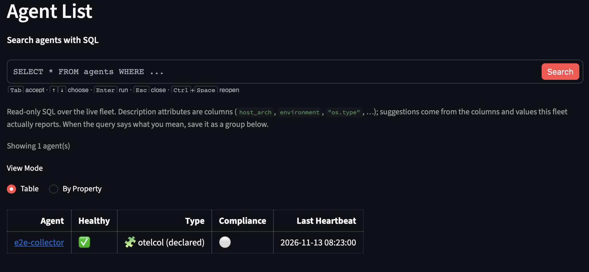

# OpAMP Server




OpenTelemetry OpAMP server in Python (FastAPI + Streamlit UI), with optional
[Open Policy Agent](https://www.openpolicyagent.org) compliance. It manages any OpAMP
agent — OpenTelemetry Collectors, Fluent Bit, or anything else that speaks the
protocol — and can be driven by humans, scripts or AI agents.

- **Select agents with SQL** — `SELECT * FROM agents WHERE host_arch = 'amd64'`, saved
  as named groups ([guide](docs/sql-agent-queries.md))
- **Push config safely** — propose → approve → canary → staged rollout, with
  validation, encryption and an audit trail ([docs](docs/remote-config.md))
- **Type-blind by protocol, typed by profile** — what the server knows about an agent
  comes from a YAML dictionary, not from a product name in the code
  ([docs](docs/agent-profiles.md))
- **Build minimal collectors** — generates an OCB `manifest.yaml` for exactly the
  components an agent uses
- **Four layers, one API** — REST + `opamp_client` + `opampctl` CLI + MCP server

Want to learn more about OpAMP? [Read the spec](https://opentelemetry.io/docs/specs/opamp/).

## Architecture

```
┌─────────────────────────┐        ┌─────────────────┐        ┌──────────────┐
│  OTel Collector         │───────▶│  OpAMP Server   │────────│  UI (:8501)  │
│  (OpAMP Extension)      │        │  (:4320)        │        └──────────────┘
└─────────────────────────┘        └─────────────────┘        ┌──────────────┐
                                           │                  │ opampctl CLI │
                                  ┌────────┴──────────────┐   │ MCP server   │
                                  │   Open Policy Agent   │   └──────────────┘
                                  │  (:8181)              │
                                  └───────────────────────┘
```

## Quick start

### Docker Compose (recommended)

```bash
docker-compose up -d                          # server + UI
docker-compose --profile opa up -d            # + OPA for compliance checking
docker-compose logs -f
```

- UI: http://localhost:8501
- Server: http://localhost:4320
- OPA (if enabled): http://localhost:8181

Pre-built multi-arch images are on GHCR (`ghcr.io/agardnerit/opamp-server-py-server` and
`…-ui`); see [development.md](docs/development.md) for the dev overlay that builds local
source with hot reload, and `release.py` for how tags become images.

Configuration lives in `.env` — that is the only place you edit. Copy `.env.sample` for a
file with every setting commented. Both services load the whole file, so a variable you
add there reaches the app whether or not `docker-compose.yml` mentions it; every setting
is documented in [configuration.md](docs/configuration.md).

There is no default admin password. On first start the server generates a random one,
prints it once in the logs, and stores it at `$DATA_DIR/admin_password` (mode 0600)
inside the `opamp-data` volume:

```bash
docker compose logs server | grep -i "admin password"
docker compose cp server:/app/data/admin_password .      # or set ADMIN_PASSWORD in .env
```

With no `.env` at all the stack still starts: read-only for writes, config push off, and
the generated password as the way in — the app's defaults are already the secure ones.
Both ports bind to `127.0.0.1` on purpose; see [Going to production](#going-to-production).

#### See your first agent

`collector/e2e.yaml` is the config CI runs against a real `otelcol-contrib`, so it is the
shortest path to a connected agent. Agents authenticate (#125), so mint a fleet token
first and hand it to the collector as an environment variable — the config reads
`Authorization: "Bearer ${env:OPAMP_AGENT_TOKEN}"`:

```bash
# stack must be up: docker compose up -d --wait
TOKEN=$(curl -sf -u "admin:$(docker compose exec -T server cat /app/data/admin_password)" \
  -H 'Content-Type: application/json' -d '{"label":"quickstart","max_agents":5}' \
  localhost:4320/agent-tokens | jq -r .token)

docker run --rm -e OPAMP_AGENT_TOKEN="$TOKEN" \
  -v "$PWD/collector/e2e.yaml:/etc/otelcol-contrib/config.yaml" \
  otel/opentelemetry-collector-contrib:0.140.0
```

Within a couple of seconds (the config polls every 2 s):

```bash
curl -s localhost:4320/agents | jq '.count, .agents[].id'   # → 1, then the id
```

…and the UI at http://localhost:8501 lists `e2e-collector` with its component list.
Ctrl-C stops the collector (`--rm` removes the container); run it again and it
reconnects as the same agent, because `agent.name` identifies it, not the container.

Two things to adjust if your setup differs:

- **`ADMIN_PASSWORD` set in `.env`**: use it instead of the `docker exec … cat`, which
  only exists when the password was generated on first boot: `-u "admin:$ADMIN_PASSWORD"`.
- **Linux**: compose publishes on `127.0.0.1`, which a bridge-networked container cannot
  reach, and `host.docker.internal` is not defined. Use host networking and point the
  name at loopback:

  ```bash
  docker run --rm --network host --add-host=host.docker.internal:127.0.0.1 \
    -e OPAMP_AGENT_TOKEN="$TOKEN" \
    -v "$PWD/collector/e2e.yaml:/etc/otelcol-contrib/config.yaml" \
    otel/opentelemetry-collector-contrib:0.140.0
  ```

### Connect a collector

Any distro that ships `extension/opampextension` works — `otelcol-contrib`, a custom
build, a supervisor-managed collector. **Using this server must never require a
proprietary or bespoke collector build.** Add the extension, name it in
`service.extensions`, and give it the bearer token:

```yaml
extensions:
  opamp:
    server:
      http:
        endpoint: http://127.0.0.1:4320/v1/opamp
        polling_interval: 5s
        headers:                          # required: agent auth is mandatory (#125)
          Authorization: "Bearer ${env:OPAMP_AGENT_TOKEN}"
    agent_description:
      non_identifying_attributes:
        "agent.name": "collector-1"      # your label; `GET /agents` shows it
        "environment": "production"

service:
  extensions: [opamp]                     # required, or the extension never starts
  pipelines:
    traces:
      receivers: [otlp]
      processors: [batch]
      exporters: [debug]
```

Mint the token with `opampctl agent-tokens create --expires-in-days 30 --max-agents 50`
(one token, many agents, no `instance_uid` needed first) and pass it as `${env:…}`.
Restart the collector, then:

```bash
curl -s localhost:4320/agents | jq '.count, .agents[].id'
opampctl agents list --pretty            # same data with names and capability tags
```

`collector/e2e.yaml` is the known-good version of the block above; it carries the same
`headers:` block and CI runs it against a real collector on every PR.

Variants — WebSocket transport, TLS termination, polling guidance, the naming rules,
the distro compatibility table and OCB manifests — are in
[connect-collectors.md](docs/connect-collectors.md). The token model, including what a
rejected agent sees, is in [agent-tokens.md](docs/agent-tokens.md).

### Transports

HTTP (poll/reply) is the default and is what the collector's `opamp` extension uses.
The same path also accepts a WebSocket upgrade, on by default (`OPAMP_WS_ENABLED=false`
refuses it). Same framing, same message handler, same auth — agent state is identical
either way, and `tests/test_ws_parity.py` asserts it.

Limits, gzip, error codes, `sequence_num` full-state asks, hash-only component lists,
stale-agent timeouts and duplicate `instance_uid` handling are in
[transports.md](docs/transports.md).

## Going to production

Default posture: **read-only for writes** (no admin credential), **config push off**,
**TLS off**, **config bodies not stored** until `CONFIG_AT_REST_KEY` is set, and agent
tokens **required**. Before exposing the port:

1. TLS in front (`docker/nginx.conf` or `docker/Caddyfile`), keep 4320 on loopback.
2. A principal per person with a role — `viewer` < `operator` < `approver` < `admin`.
3. A fleet token in every agent's config.
4. `CORS_ORIGINS` set to the UI's origin, not `*`.
5. `CONFIG_AT_REST_KEY` set before enabling push.

Config push refuses to start unless all of that is in place. The checklist, the auth
model, lockout and the hash-chained audit log are in [security.md](docs/security.md);
the full variable list is in [configuration.md](docs/configuration.md).

## Documentation

| Page | What's in it |
|---|---|
| [docs/connect-collectors.md](docs/connect-collectors.md) | WebSocket, TLS, polling, naming, distro matrix, OCB |
| [docs/agent-tokens.md](docs/agent-tokens.md) | Fleet vs bound tokens, first run, rotation, cutover |
| [docs/transports.md](docs/transports.md) | Wire limits, gzip, full-state asks, liveness, duplicate uids |
| [docs/remote-config.md](docs/remote-config.md) | Push, propose → approve, rollouts, validation, secrets |
| [docs/groups.md](docs/groups.md) | Named SQL selectors as push targets |
| [docs/sql-agent-queries.md](docs/sql-agent-queries.md) | The SQL language, schema, examples, errors |
| [docs/agent-profiles.md](docs/agent-profiles.md) | The agent-type dictionary and its guardrails |
| [docs/api-reference.md](docs/api-reference.md) | Every endpoint, its role and its failure codes |
| [docs/cli.md](docs/cli.md) | `opampctl`: commands, configuration, offline mode |
| [docs/mcp.md](docs/mcp.md) | The MCP server and which tools an AI may have |
| [docs/python-client.md](docs/python-client.md) | `opamp_client` recipes |
| [docs/security.md](docs/security.md) | Posture, roles, principals, lockout, audit log |
| [docs/configuration.md](docs/configuration.md) | Every environment variable, alerts, OPA |
| [docs/operations.md](docs/operations.md) | Capacity, overload shedding, the SQLite trap, metrics, logs |
| [docs/telemetry.md](docs/telemetry.md) | OTLP ingestion and why panels can be absent |
| [docs/capabilities.md](docs/capabilities.md) | Spec version and the capability matrix |
| [docs/spec-conformance.md](docs/spec-conformance.md) | Clause-by-clause conformance and deviations |
| [docs/development.md](docs/development.md) | Dev overlay, tests, e2e, protobuf, project layout |
| [docs/updates-available.md](docs/updates-available.md) | The in-product update check |
| [docs/release-emails.md](docs/release-emails.md) | The optional release-announcement list |

The [`skills/opamp-server/SKILL.md`](skills/opamp-server/SKILL.md) file is the same
material written for an AI agent: when to use which layer, quickstart, gotchas.

## License

Apache License 2.0 — see [LICENSE](LICENSE). The server speaks the OpenTelemetry OpAMP
protocol and has no proprietary components: any collector distro with the upstream
`opamp` extension interoperates without modification.
