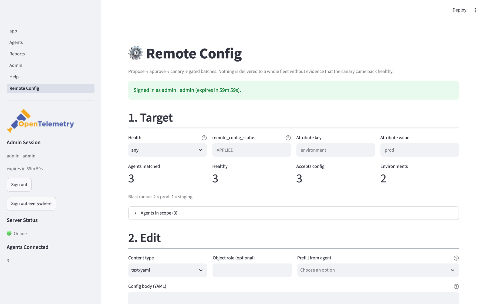
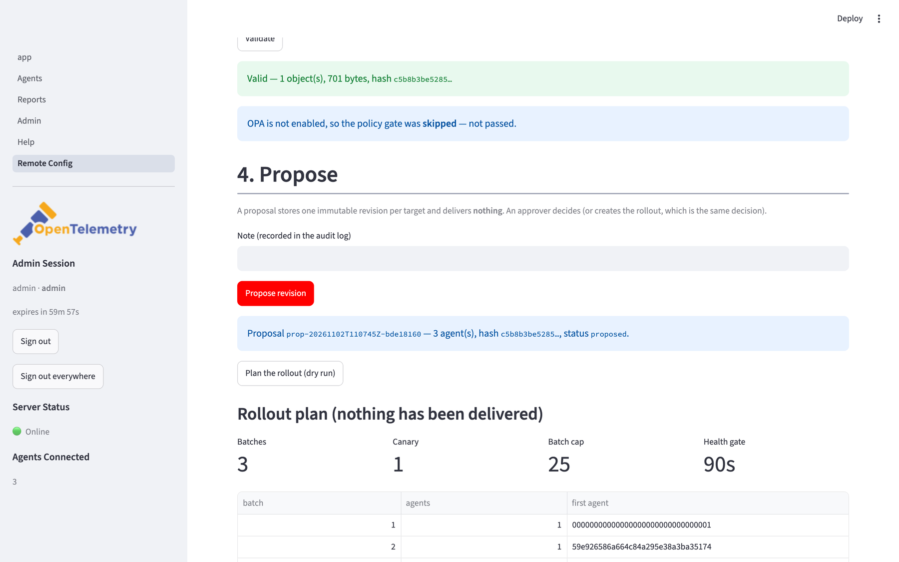
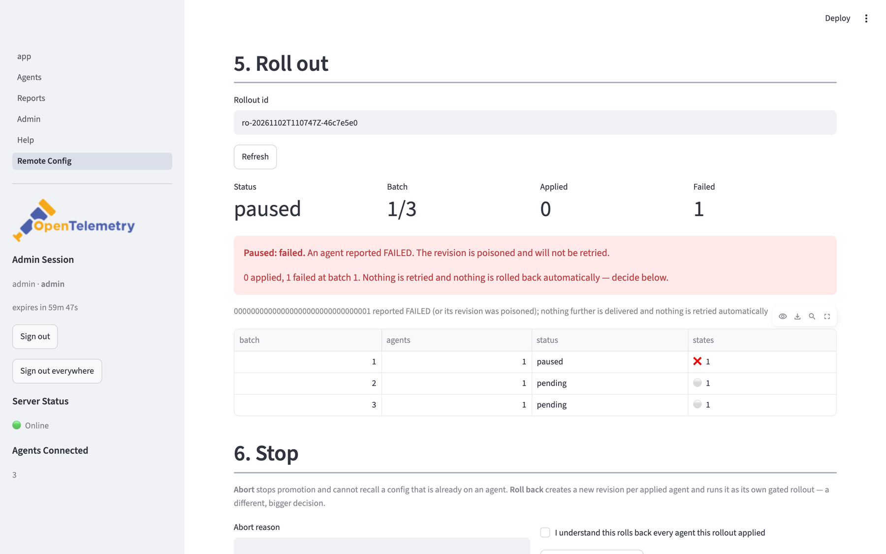

# Remote config: push, approve, roll out

Config push is off by default. When the [posture](security.md#before-you-expose-this-server)
is secure and `OPAMP_CONFIG_PUSH_ENABLED=true`, the server stores a *desired* config
per agent and delivers it — it is desired state, not a command, so it survives
restarts and is idempotent.

- [The Remote Config page (UI)](#the-remote-config-page-ui)
- [Push a config](#push-a-config)
- [Propose → approve → roll back](#propose--approve--roll-back-99)
- [Staged rollouts](#staged-rollouts-101)
- [What validation can and cannot promise](#what-validation-can-and-cannot-promise-100)
- [Config objects](#config-objects-68)
- [Config data and secrets](#config-data-and-secrets)
- [Custom capabilities and messages](#custom-capabilities-and-messages-85)
- [Groups as targets](groups.md)

## The Remote Config page (UI)

Streamlit page **Remote Config** (`ui/pages/5_Remote_Config.py`) implements the whole
flow, in the epic's order and with review between every step: **Target** (filters, live
count, blast-radius breakdown) → **Edit** (with prefill from an agent's effective config,
and a hard refusal of redacted bodies) → **Validate** (YAML paths, warnings, policy gate)
→ **Propose** (a draft that delivers nothing) → **Plan** (the rollout's real batches and
caps, from the dry run) → **Approve & roll out** (approver: canary released, the rest
held) → **live progress** (per-batch and per-agent state, pause reason, gate countdown)
→ **Stop** (abort vs rollback, visibly different) → **History** (rollouts and revisions,
with who approved what).

It is a session-token client (#105): buttons are role-gated in the page *and* the server
re-authorises every call, so the UI is ergonomics and never the boundary. Config bodies
are never listed; the per-agent reveal stays on the Agents page where it is audited.



*Step 1 — the fleet is counted and broken down by environment before anything is edited.*



*The plan is the review screen: real batches, canary size, caps and the health gate. The
button below it is the only way a rollout starts.*



*A paused rollout names its one reason and shows which batch failed; abort and rollback are
separate, differently-gated actions below.*

## Push a config

```bash
# 1. Validate without storing anything (safe; this is what an AI agent may do)
opampctl --password "$ADMIN_PASSWORD" config validate --file collector.yaml
# {"valid": true, "config_hash": "9101…", "size_bytes": 214, "objects": 1}

# 2. Push to one agent (approver role)
opampctl --password "$ADMIN_PASSWORD" agents config set <agent-id> \
  --file collector.yaml --note "add otlp receiver"

# 3. Watch what the agent says about it
opampctl --password "$ADMIN_PASSWORD" agents config get <agent-id>

# 4. Fleet-wide, explicitly targeted and explicitly confirmed (admin role)
opampctl --password "$ADMIN_PASSWORD" config apply --file collector.yaml \
  --attr environment=prod --confirm

# 5. Withdraw: an empty config map, which tells the agent to run its local config
opampctl --password "$ADMIN_PASSWORD" agents config withdraw <agent-id>

# 6. Deliver now: re-send the active revision over the agent's live connection
#    (no new revision, no approval — a latency optimisation, not a new decision)
opampctl --password "$ADMIN_PASSWORD" agents config deliver <agent-id>
```

How delivery works:

- The agent must advertise `AcceptsRemoteConfig` — the spec's MUST. The
  collector's `extension/opampextension` never does; the **OpAMP Supervisor**
  (`cmd/opampsupervisor`) does, and it is the only agent that can actually apply a
  pushed config (it restarts the collector and auto-reverts on failure).
- The server compares the hash the agent reports (`RemoteConfigStatus.
  last_remote_config_hash`) with its own. Equal → nothing is sent. Different →
  the reply carries `remote_config`. That is the spec's reconciliation rule and
  what stops a re-push loop. Two hashes count as "its own" (#136): the one on the
  wire, `sha256` of the deterministic protobuf serialisation of the config map
  (this is what the spec means, and what a verifying agent re-derives), and the
  server's canonical storage hash, which an agent holding a pre-#136 push still
  echoes back.
- The hash in API responses and audit rows is the **storage** hash. It is
  length-prefixed and key-sorted so a stored revision keeps one identity across
  re-serialisation and the #68 role field; it is deliberately not the wire hash.
- **Desired state, not a command** (#102, epic #93 D5). The revision is stored
  once and delivered when the agent's hash differs. A live WebSocket connection
  only removes the wait for the next report: the server hands the frame to that
  connection immediately. There is one decision function behind both transports,
  so a push can never deliver something a poll would refuse.
- Every push response carries a `delivery` object instead of a promise:

  | `delivery.state` | Meaning |
  |---|---|
  | `delivered` | Handed to the agent's live WebSocket connection (`channel: "push"`) |
  | `queued` | No live connection, throttled, or refused — it arrives on the agent's next status report (`delivery.detail` says when) |
  | `unchanged` | Nothing to deliver; `delivery.reason` says why (`reported_hash_matches`, `revision_not_deliverable`, `attempts_exhausted`, `agent_does_not_accept`, …) |

  Nothing is ever called **applied** until the agent reports `APPLIED` for our
  hash. `GET /agent/{id}/config` → `assignment.state` is the same vocabulary,
  derived: `none | queued | delivered | applied | failed | poisoned | unconfirmed`.
- Delivery is recorded when the frame is **written**, not when it is queued: a
  dropped or superseded frame consumes no attempt, so the next report re-offers
  it. That is what makes a bounded send queue safe.
- A rollout cannot starve heartbeats on a shared socket: config frames ride a
  per-connection token bucket (`CONFIG_PUSH_RATE_PER_SECOND`,
  `CONFIG_PUSH_BURST`) plus a global in-flight cap
  (`CONFIG_PUSH_MAX_CONCURRENT`), and a throttled frame is simply `queued`.
  `opamp_ws_push_sent_total{outcome}` and `opamp_ws_config_pending` make that
  visible; `opamp_config_delivery_latency_seconds{channel}` measures written →
  `APPLIED`.
- `opampctl agents config deliver <agent-id>` (or `POST
  /agent/{id}/config/deliver`) re-delivers the **already approved** revision now.
  It moves no pointer and needs only `operator`, because there is nothing to
  approve — it is the manual lever for "the queue dropped that frame".
- **Never retried automatically.** A `FAILED` status for our revision poisons it:
  it is surfaced in the API, the UI and the audit log (`config.apply.failed`), and
  will not be sent again. Push a new revision or roll back — a human decision,
  on purpose.
- Hashes are SHA-256 over a length-prefixed, key-sorted encoding of the config
  map. Spec §Calculating Hashes makes the hash server-defined ("the Agent never
  calculates hashes, it only stores and compares them"), which the supervisor
  confirms: it echoes back exactly the hash we sent.
- Validation before storage is two layers that answer different questions (#119).
  The **format layer** is true of any body: shape, size (`CONFIG_MAX_BYTES`), a bounded
  YAML/JSON parse, duplicate keys, no redaction marker. The **structure layer** is the
  target profile's: for `otelcol` that is `server/profiles/otelcol.py` (pipelines,
  component references, the `opamp` extension's protected invariants, the
  `memory_limiter`/`batch` advice, the exporter allowlist), and a profile with no
  structure engine is not judged at all — its config is opaque text to this server. That
  is why a FluentBit body is accepted with "no structural checks ran" instead of being
  refused as a broken collector, and why **approving** one needs
  `confirm_unchecked_structure`: nobody, including the server, checked that the config
  leaves the agent able to start. The acknowledgement is stored on the revision and in
  the audit row.

## Propose → approve → roll back (#99)

A direct push is approval-by-fiat: the caller holds `approver`. The two-phase flow
separates the duties, which is the point of having roles at all.

```bash
# 1. Propose: validates, drafts one immutable revision per target agent, delivers
#    NOTHING. Operator role. One of --agent / --agents / --attr is required.
opampctl --password "$ADMIN_PASSWORD" config propose --file collector.yaml \
  --attr environment=prod --note "add otlp receiver"
# {"proposal_id": "prop-…", "status": "proposed", "agents": 3, "verdict": {...}}

# 2. Review the blast radius and the verdict (metadata only, never a body)
opampctl --password "$ADMIN_PASSWORD" config show prop-…
opampctl --password "$ADMIN_PASSWORD" config revisions --status proposed

# 3. Approve: re-resolves the selector, re-runs validation, supersedes and activates
opampctl --password "$ADMIN_PASSWORD" config approve prop-… --note "reviewed"

# 4. Something went wrong: roll back to the previous revision (a new revision,
#    so history stays append-only and the chain records what replaced what)
opampctl --password "$ADMIN_PASSWORD" agents config rollback <agent-id> --note "v2 broke tracing"

# 5. A poisoned revision never returns on a timer — an approver decides
opampctl --password "$ADMIN_PASSWORD" config reactivate prop-… --reason "component now installed"
```

Lifecycle: `proposed → active → superseded | rolled_back | poisoned`, plus
`rejected` from `proposed`. Only `active`, unpoisoned revisions are deliverable.

- **Immutable revisions.** Nothing edits a body. Rollback creates a new revision
  whose `parent_revision_id` names the old one.
- **One active revision per agent.** Approving supersedes the previous one, which
  stays available for rollback for `CONFIG_RETENTION_DAYS`.
- **The selector resolves at approve time**, and the resolved list is stored. An
  agent that starts matching between propose and approve is captured — but if that
  widens the set, the approval is refused until the approver repeats it with
  `confirm_scope_change: true` (`added` / `dropped` report the diff). An agent that
  stops matching is skipped. Agents that arrive *after* approval inherit nothing
  unless the proposer set `include_future` on a selector scope.
- **Auto-revert detection (T9).** The OpAMP Supervisor restores
  `last_working_remote_config.dat` when a new config fails and then reports the
  *old* hash. A naive hash comparison re-pushes the broken config forever. The
  server records `delivered_hash` per agent and treats "a known older revision
  reported after we delivered ours" (past a grace window, or on an explicit
  `FAILED`) as an auto-revert: it poisons the revision and stops sending
  (`config.apply.failed` with `reason: auto_reverted`).
- **Delivery is bounded.** `CONFIG_MAX_DELIVERY_ATTEMPTS` frames per assignment;
  an agent that never acknowledges is surfaced as `unconfirmed` instead of being
  re-pushed forever. The budget is per episode, not permanent:
  `CONFIG_UNCONFIRMED_RETRY_SECONDS` (default 300, `0` = never) gives an
  unacknowledged assignment a fresh budget, and a matching `APPLIED` clears it
  immediately — otherwise an agent whose process restarted, and which therefore
  reports no hash at all, could never be configured again.
- **Drift** is visible per agent (`GET /agent/{id}/config` → `drift` with the
  missing YAML paths) and fires **one** `config_drift` alert per (agent, revision),
  never one per poll.

## Staged rollouts (#101)

The failure this engine exists for: one typo, four hundred collectors down, and
because their `opamp` extension is no longer running there is no remote way to fix
them (upstream is explicit that an invalid config leaves the collector down until a
manual restart). So a rollout never moves from one agent to two hundred without
evidence that agent one came back healthy.

```
canary (CONFIG_PUSH_CANARY_PERCENT, ≥1 agent)
   → every agent APPLIED *with our hash*      ┐
   → every agent healthy                     │ promotion gate
   → no agent silent since delivery          │ (all must hold)
   → CONFIG_PUSH_HEALTH_GATE_SECONDS elapsed ┘
   → next batch, capped at CONFIG_PUSH_MAX_AGENTS_PER_BATCH *and*
     CONFIG_PUSH_MAX_PERCENT_PER_BATCH → … → completed
```

- **Approval assigns, the rollout releases.** Every revision becomes the agent's
  desired config at approval time but is **held** (`desired_configs.held`), so an
  HTTP agent polling in the meantime is refused the config (`held_by_rollout`) until
  its batch is promoted. The hold is written in the same statement as the
  assignment, so there is no window in which a report could collect an unpromoted
  config. Any *new* revision releases the hold, which is the escape hatch after an
  abort.
- **Deterministic batches.** Targets are sorted, so the same fleet produces the
  same plan; the plan is stored per agent (`config_rollout_agents.batch_index`)
  rather than recomputed, so a rollout is reproducible in a test and reviewable
  before it runs.
- **A failure pauses; it never rolls the fleet back.** Rolling back 300 agents
  because one failed is a second outage. The pause carries one reason
  (`failed`, `auto_reverted`, `agent_went_silent`, `unhealthy`,
  `config_conflict`, `delivery_unconfirmed`, `superseded`) and the summary is "N applied, K failed,
  paused at batch 2". The decisions stay human: retry the failed agents (an approver
  `reactivate`, #99), re-open a pause whose cause was on the agent (`resume` — the
  revision is fine, a second config source on the host was not) or roll back the
  applied ones — which runs as its own rollout, canary first, gated the same way.
- **The HTTP surface** (#103): `POST /config/rollouts?proposal_id=…` creates a rollout
  (approver; `dry_run: true` plans without approving), `GET /config/rollouts` and
  `GET /config/rollouts/{id}` read it (viewer), `POST /config/rollouts/{id}/abort`
  stops it (operator), `POST /config/rollouts/{id}/resume` re-opens a paused one after
  the cause is fixed on the agent (approver; nothing is re-delivered) and
  `POST /config/rollouts/{id}/rollback` undoes it as its own gated rollout (approver). `POST /config/revisions/{id}/apply` is the same operation
  under the flow's own verb, and `POST /config/revisions/{id}/validate` re-runs the
  pipeline without changing anything. From the shell:
  `opampctl config rollout plan|create|show|abort|resume|rollback <id>`,
  `opampctl config rollouts`, `opampctl config revalidate <proposal>`.
- **Abort stops promotion immediately, and cannot recall.** `abort()` stops the
  next batch, leaves already-applied agents exactly as they are (the config is on
  the agent and it is running it), and leaves un-promoted agents held so a stopped
  rollout can never widen.
- **A stalled rollout expires.** `CONFIG_PUSH_ROLLOUT_TTL_MINUTES` (default 60)
  cancels a running or paused rollout, audits `config.rollout.cancelled` with
  `reason: ttl_expired`, and leaves the remaining holds in place — an approval
  nobody acted on must not fire three weeks later against a fleet that has moved on.
- **Gates are pure functions.** `rollout.batch_gate()` takes the agent facts, the
  window and a clock value; it has no database, env or wall-clock dependency, so
  "the gate never opened" is an assertion about values. `APPLIED` is only evidence
  when the reported hash is *ours*, after base64→hex conversion — naive equality is
  how a rollout promotes on an agent that is running something else.
- **One background task, not a thread per rollout.** `rollout_loop()` ticks every
  `CONFIG_PUSH_TICK_SECONDS` (default 5) in a worker thread and does nothing at all
  when config push is disabled.
- **Observability:** `opamp_config_rollout_agents_total{state}`,
  `opamp_config_rollout_paused_total{reason}`,
  `opamp_config_rollout_promoted_total{kind}`,
  `opamp_config_rollout_status{status,kind}`,
  `opamp_config_rollout_batch{status}`, and one structured log line per batch
  transition (`event=config.rollout.batch`). Pauses, completions, cancellations and
  aborts are audit rows.

## What validation can and cannot promise (#100)

The server cannot prove a config will not crash a collector — that is why rollout
staging (#101) and the supervisor's auto-revert exist. It *can* refuse the
recognisable mistakes, and it does, in this order:

1. **Shape and size** — `CONFIG_MAX_BYTES` (1 MiB), and a **redacted** body is
   always refused (pushing one would wipe every credential in the fleet).
2. **Bounded parse** — `yaml.safe_load` only, via a loader that enforces an alias
   budget, a depth budget (`CONFIG_MAX_DEPTH`), an expanded-node ceiling
   (`CONFIG_MAX_NODES`, the alias-bomb guard) and **rejects duplicate keys**
   instead of PyYAML's silent last-wins.
3. **Structural rules** (for a complete config — one with a `service` section):
   every pipeline has at least one receiver and one exporter, and every referenced
   `receivers|processors|exporters|extensions` id exists in the matching section.
   A body with no `service` is treated as a fragment and only warned about; a body
   with no collector sections at all (a PEM file, a routing table) is not judged.
4. **Protected invariants (D7)** — `extensions.opamp` must exist **and** `opamp`
   must be in `service.extensions`, otherwise the agent loses its control channel
   and can never be fixed remotely. Moving the `opamp` endpoint away from this
   server is refused unless the request sets `allow_endpoint_change` **and** the
   approver confirms it.
5. **Warnings that do not block** — no `memory_limiter`, no `batch`, telemetry
   removed, an exporter host outside `CONFIG_ALLOWED_EXPORTER_HOSTS`, and any
   component the target agent does not ship (its reported
   `available_components`).
6. **Policy gate** — the project's OPA policies run against the proposed config.
   Violations block; an `approver` may override with a recorded reason (audited
   as `config.override`). When OPA is disabled the verdict says `skipped`, never
   "passed".

Validation runs at **propose** and again at **approve**: a config approved on
Monday must not be delivered on Friday without re-checking, because the schema,
the policies and the agent's inventory may all have changed (`409 re-validate: …`).

The verdict is `{ok, errors: [{path, message, hint, severity}], warnings, policy,
fingerprint, checked_at}` with YAML paths (`service.pipelines.traces.receivers[0]`)
so a UI or CLI can point at the problem.

## Config objects (#68)

`EffectiveConfig.config_map` holds **configuration objects**, and their keys are
agent-implementation-defined: `""` is valid and has no privileged meaning
([spec v0.20.0 §Configuration Objects](https://github.com/open-telemetry/opamp-spec/blob/v0.20.0/specification.md)).
`otelcol-contrib` with `reports_raw_config: true` reports two — the expanded config
under `""` and the raw config under `"raw"` — and other agents use `"collector"`,
`"config"`, … `AgentConfigObject` also carries an optional `role`, which is likewise
agent-defined.

`server/effective_config.py` is the one reader (`server/state.py` and the UI both go
through it, and `ui/config_view.py` renders it):

- **Every object is read.** Components reported by different objects are unioned, so a
  partial or alternative representation cannot hide a receiver, and none is counted
  twice.
- **Non-YAML is skipped, never raised.** A content type that is set and is not YAML, a
  body that is not UTF-8, a body that does not parse, a document that is not a mapping
  — each is skipped with a debug log naming the key, and the rest are still read.
- **Parsing is bounded** (the same loader the config validator uses: alias, depth and
  expansion budgets; duplicate keys refused), because the document comes from an agent.
- **`""` is preferred for display.** The "Configuration" panel shows the `""`
  object when it parses, otherwise the first parseable object, untagged before
  role-tagged. A role marks an alternative representation, not the primary one.
- **Display accepts JSON as well as YAML.** An osquery agent reports its config as
  `application/json`; the panel decodes it and shows the `schedule` as-is. The
  component and agent-type paths stay YAML-only, so an arbitrary JSON document is
  never mistaken for collector config, and the collector telemetry augmentation is
  applied only to a collector-shaped document.
- **Editing is a proposal, not a push (#131).** When the server may push config
  (`OPAMP_CONFIG_PUSH_ENABLED`, per `GET /health`) *and* the agent advertises
  `AcceptsRemoteConfig`, the agent detail's config box is an editor: the body it holds
  is the agent's own, decoded (`editable_config`), never the augmented display view.
  *Propose* stores a revision — `POST /config/revisions`, scoped to that one agent and
  keyed by the object name the agent reported — and an approver creates the gated
  rollout on the Remote Config page. A redacted report never reaches the editor, and a
  body carrying a redaction artefact is refused by the server as well as the UI.
- **A body the server does not interpret says so (#121).** `ui/config_view.editor_note()`
  prints one paragraph beside both editors: whose profile's format this is, what content
  types that profile declares, and — when `validates_structure` is false — that the body is
  stored and relayed as **opaque text**, so a validation pass means well-formed, not valid
  for that agent. It returns `None` for an all-`otelcol` selection, so the interpreted case
  gains no prose.

A role is carried end-to-end by the push path too: validated (and bounded to 128
characters), included in the canonical hash **only when set** — so revisions stored
before v0.20.0 keep their hash and are not re-pushed after an upgrade — and set on the
`AgentConfigObject` delivered to the agent.

## Config data and secrets

Config bodies are the most sensitive data this server holds: exporter auth
headers, basic-auth extensions, TLS keys, internal endpoints. Three rules apply
everywhere (`server/redaction.py`, `server/crypto.py`):

**Redacted by default.** `GET /agents`, `GET /agent/{id}`, the reports, the alert
payloads, the CLI, the MCP server and the UI all pass through one filter. Keys that
look like credentials (`password`, `api_key`, `authorization`, `client_secret`,
`private_key`, …) are replaced with `<redacted>` at any depth, and auth-shaped
values (`Authorization: Basic …`, `https://user:pw@host`) are masked by shape. Each
response says what was hidden:

```bash
opampctl --password "$ADMIN_PASSWORD" agents config get <agent-id>
# {"desired": {...}, "effective": {"redacted": true,
#   "redacted_paths": ["configMap.configMap[].body"], ...}}
```

Base64 bodies (OpAMP bodies are `bytes`, and `MessageToDict` renders them base64)
are decoded, scrubbed and re-encoded — otherwise the filter would see nothing.

**Revealing is a separate, audited action.** `GET /agent/{id}/config?reveal=true`
needs the `approver` role (or higher), writes a `config.reveal` audit row and sets
`Cache-Control: no-store`. It is not exposed over MCP at all: an AI client has no
business reading fleet credentials.

**A redacted body can never be pushed.** A redacted document is a display
artefact; pushing one would silently wipe every credential in the fleet. Any
`PUT /agent/{id}/config` whose body contains `<redacted>` (or the redaction marker)
is a 422.

**Encrypted at rest.** Bodies are sealed with AES-256-GCM, bound to the row they
belong to (AAD = `agent:<id>` / `revision:<id>`), so copying a ciphertext between
rows fails to decrypt instead of handing an agent someone else's config:

```bash
# Generate a key (32 bytes, base64) and keep it out of git
python -c "import os,base64; print(base64.b64encode(os.urandom(32)).decode())"
CONFIG_AT_REST_KEY=...        # .env or a secret mount
```

Rotation is three steps: set the new `CONFIG_AT_REST_KEY`, put the old key in
`CONFIG_AT_REST_KEY_PREVIOUS`, run `opampctl config rotate-key --db data/opamp.db`,
then drop the previous key. Rows still sealed with a key you no longer supply fail
closed with an error naming the key id — they are never silently replaced with
NULL, so supplying the key later still works.

**Losing the key loses desired config, not the fleet.** Agents keep running the
config they last applied, and the server can rebuild desired state from the
`effective_config` each agent reports. Say that to your incident channel before
you need it.

**Reported configs can contain secrets you did not push.** Upstream warns that the
collector's `reports_raw_config` option exposes the full contents of the collector's
config files. Leave it off unless you trust this server with them.

Retention: superseded revisions keep their hash, author and timestamps but lose
the body after `CONFIG_RETENTION_DAYS` (default 30). The current revision is never
pruned — a restart must not forget the fleet.

## Custom capabilities and messages (#85)

Some collector features never make it into the core spec; OpAMP reserves a
reverse-FQDN namespace for them (`CustomCapabilities` / `CustomMessage`, both marked
*Development* upstream). The agent advertises what it supports, and the server can send
a message for one of those capabilities:

```bash
opampctl agents show <id> | jq '.custom_capabilities'      # what this agent supports
opampctl --password "$ADMIN_PASSWORD" agents custom send <id> \
    --capability io.opentelemetry.pause --type pause       # empty payload is valid
```

The **payload contract belongs to the capability**. The server validates the
capability against the agent's advertised list, carries `data` through byte-for-byte
(base64 in the API, bytes on the wire) and never interprets, stores or audits the
payload — a generic transport is the only honest implementation of an opaque
capability, and guessing at a third-party payload would corrupt it. Four properties
are enforced and tested:

- the capability list is **replaced** on every report, never appended (the spec's
  message carries the whole list);
- a message for an **unadvertised** capability is a 400 that lists what the agent does
  support — the agent is entitled to ignore it, and "nothing happened" reads as a bug;
- delivery is **exactly once** (the queue is persisted, so a restart does not lose it,
  and cleared *before* the reply is serialised, so it is not repeated), and the config
  offer waits one poll because a reply carries one server-initiated action;
- `OPAMP_CUSTOM_MESSAGES_ENABLED=false` removes the surface entirely.
