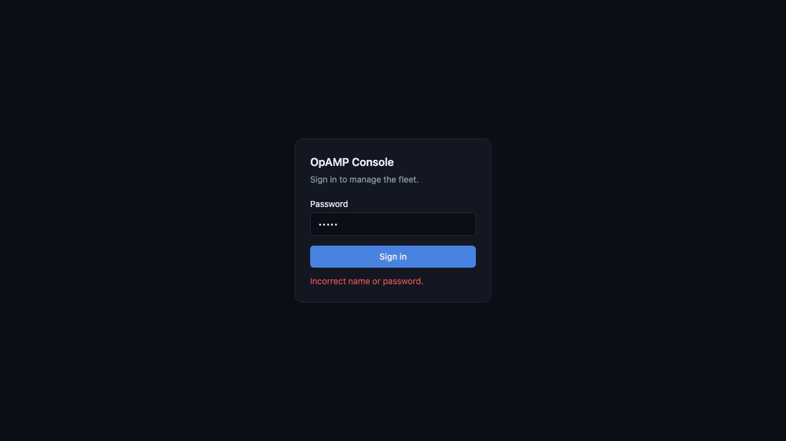

# OpAMP Console — frontend

React 19 + TypeScript (strict) + Vite + Tailwind v4 + shadcn/ui (Radix) +
TanStack Query/Router. See `../new-ui-plans.md` for the staged plan; this UI
replaces the Streamlit UI (`ui/`) page by page until full parity.

## Development

```bash
npm install
npm run dev            # http://localhost:5173, proxies /api -> 127.0.0.1:4320
```

The FastAPI server must be running for live data (see `../startDevStack.sh`).
Without it, run against the built-in fixtures:

```bash
VITE_USE_MOCK_API=1 npm run dev
```

## Quality gates

```bash
npm run build   # tsc -b (strict) + vite build
npm run test    # vitest (always mock transport — no live server needed)
npm run lint    # oxlint
npm run e2e     # Playwright (mock-mode dev server; stage 3: auth round-trip)
```

## Auth (cookie sessions, stage 3)

The browser authenticates with the httpOnly `opamp_admin_session` cookie the
server sets on `POST /auth/session` (bearer tokens stay for CLI/API clients).
Consequences baked into this codebase:

- The session token is **never** in JS state: `login()` in `endpoints.ts`
  discards it, nothing is persisted to `localStorage`, and identity/role/expiry
  come from `GET /auth/me` via the `useSession` hook (`src/api/session.ts`).
- A relogin-classified error (401) anywhere drops session state and routes to
  `/login` via the global handler registered in `src/main.tsx` — a failed login
  form is also a 401, but it is already on `/login` and surfaces inline.
- "Extend" in the session slot is the audited re-auth (`extendSession`): fresh
  credentials, DELETE old session, then POST the new one. The order is inverted
  from the Streamlit flow because the cookie must still point at the old session
  when the DELETE lands.

Latest screens (mock-mode fleet fixtures):

| | |
|---|---|
|  |  |
| Agents list + session slot (role, expiry, Extend, Sign out) | Login with the 401 message |
|  | |
| Sidebar at nav parity (stage 4): main pages + role-gated Admin section | |

## Navigation (stage 4)

The sidebar mirrors `ui/app.py`'s `st.navigation` tree so every Streamlit page
stays reachable during the migration: Agents (`/`, default), Reports, Groups,
Remote Config, Help, plus an **Admin** section (Alerts, Compliance, Agent
tokens, Sessions, Updates, Release emails) with flat URLs like Streamlit's.
The Admin section and its admin-only items (Agent tokens, Sessions) are gated
client-side by the role ladder in `src/lib/roles.ts` — a hint only; the
server's `require_roles` is the authority. Pages not yet built render a
`StubPage`; unknown URLs land on the root `NotFound`; route render crashes hit
the `RootError` boundary.

## Regenerating the API types

`src/api/schema.d.ts` is generated from the live server's OpenAPI schema —
never hand-edit it. Start the server, then:

```bash
npm run gen-api
# or: OPENAPI_URL=http://other-host:4320/openapi.json npm run gen-api
```

The codegen runs in `tools/api-codegen/` (its own package.json pinning
TypeScript 5.x) because this project compiles with TypeScript 7 (native), which
openapi-typescript does not yet support at runtime.

## API layer conventions

- All HTTP goes through `src/api/client.ts` (openapi-fetch, bound to `/api`).
  Components never call `fetch`.
- 401/403/429/503 semantics are normalized in exactly one place,
  `src/api/errors.ts`, mirroring `ui/session.py::classify_response`:
  401 ⇒ drop the session and show login (`relogin`), 403 ⇒ keep the session
  (role refusal vs. read-only mode), 429 ⇒ lockout with retry-after,
  503 ⇒ audit-store refusal. Use `unwrap()` in `src/api/endpoints.ts`.
- Payloads the server types as `Dict[str, Any]` (schema says `unknown`) get a
  narrow interface in `src/api/endpoints.ts` mirroring the server
  (`AgentState.to_dict()`, `credential_summary()`, …).
- Mock mode: handlers + fixtures in `src/api/mock.ts` / `fixtures.ts`; Playwright
  and offline dev use `VITE_USE_MOCK_API=1`. The mock auth handlers are
  stateful (a flag stands in for the cookie) so the login → shell → logout
  round-trip is exercised without a server.
- Design tokens live in `src/index.css` (`--color-*`); never hard-code colors in
  components.
