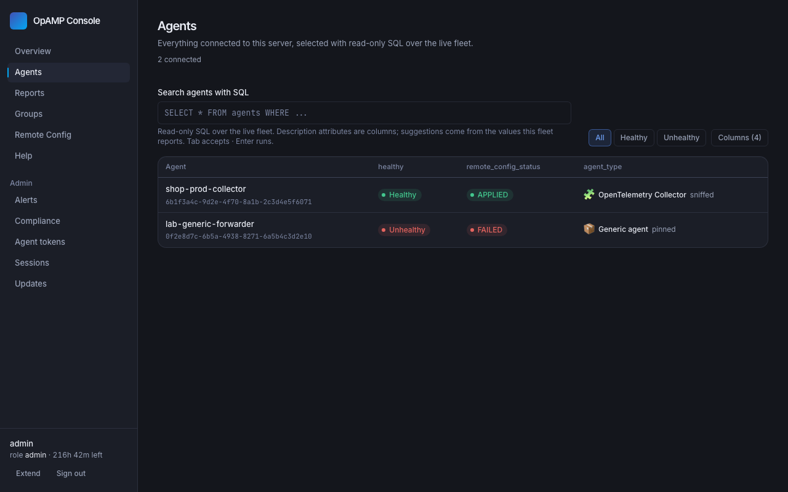
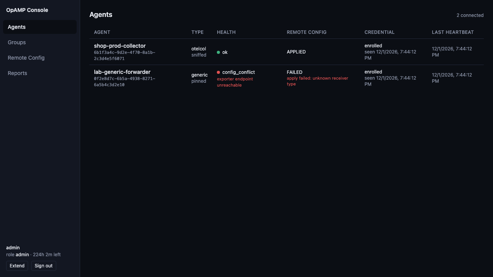

# OpAMP Console — frontend

React 19 + TypeScript (strict) + Vite + Tailwind v4 + shadcn/ui (Radix) +
TanStack Query/Router. See `../new-ui-plans.md` for the staged plan; this UI
replaces the Streamlit UI (`ui/`) page by page until full parity.

## Development

```bash
npm install
npm run dev            # http://localhost:5173, proxies /api -> 127.0.0.1:4320
```

The FastAPI server must be running for live data (see `../startDevStack.sh`).
Without it, run against the built-in fixtures:

```bash
VITE_USE_MOCK_API=1 npm run dev
```

## Quality gates

```bash
npm run build   # tsc -b (strict) + vite build
npm run test    # vitest (always mock transport — no live server needed)
npm run lint    # oxlint
npm run e2e     # Playwright (mock-mode dev server; stage 3: auth round-trip)
```

## Auth (cookie sessions, stage 3)

The browser authenticates with the httpOnly `opamp_admin_session` cookie the
server sets on `POST /auth/session` (bearer tokens stay for CLI/API clients).
Consequences baked into this codebase:

- The session token is **never** in JS state: `login()` in `endpoints.ts`
  discards it, nothing is persisted to `localStorage`, and identity/role/expiry
  come from `GET /auth/me` via the `useSession` hook (`src/api/session.ts`).
- A relogin-classified error (401) anywhere drops session state and routes to
  `/login` via the global handler registered in `src/main.tsx` — a failed login
  form is also a 401, but it is already on `/login` and surfaces inline.
- "Extend" in the session slot is the audited re-auth (`extendSession`): fresh
  credentials, DELETE old session, then POST the new one. The order is inverted
  from the Streamlit flow because the cookie must still point at the old session
  when the DELETE lands.

Latest screens (mock-mode fleet fixtures):

| | |
|---|---|
|  |  |
| Agents list (stage 5): server-side SQL selection, health chips, schema columns, type + provenance badges | Collector detail (stage 5): profile-declared telemetry panels, component inventory, masked config flagged |
|  |  |
| Agents list + session slot (role, expiry, Extend, Sign out) | Login with the 401 message |
|  | |
| Sidebar at nav parity (stage 4): main pages + role-gated Admin section | |
|  | |
| Remote Config (stage 6): target → edit → review → propose → approve, with the rollout monitor below after creation | |
|  |  |
| Groups (stage 7): search → save → inspect (kind, pins, drift) → preview/edit/delete, all server-resolved | Reports (stage 7): the fleet's profiles decide which reports are offered; the server's markdown, rendered and downloadable |

## Read pages: Reports, Groups, Help (stage 7)

- **Reports** (`src/routes/Reports.tsx`): the server generates the markdown
  (`GET /reports/fleet`, `/reports/heavy-collectors`, `/reports/outdated-collectors`);
  the page renders it and offers the download. Which reports are offered is the
  union of what the fleet's profiles declare (`lib/reportTypes.ts`) — a fleet
  with no component concept is never offered "Heavy agents".
- **Groups** (`src/routes/Groups.tsx`): a group is a **saved SQL selection** —
  search first (the same `SqlSearch` box as Agents), then name it. Running and
  previewing are viewer actions; save/edit/delete need `operator` (hinted, the
  server re-authorises). The detail panel shows selector vs pins (`sources`),
  unknown pins, health-defined warnings and the drift count; delete confirms and
  surfaces a live-rollout 409. Full CRUD lives in `src/api/groups.ts`.
- **Help** (`src/routes/Help.tsx`): the universal connect facts (endpoint +
  agent token), the profile dictionary from `GET /agent/types`, token model, the
  SQL selection language (`docs/sql-agent-queries.md` is the full reference) and
  the session/role security model.
- The report markdown subset (`#/##/###`, bullets, `**bold**`) is rendered by
  `lib/markdown.ts` + `components/Markdown.tsx` — dependency-free, and
  XSS-safe by construction (agent-supplied attribute values stay text nodes).

## Remote Config (stage 6)

The highest-stakes flow, built around **review before action**, not around a big
red Push button (`src/components/config/ComposeStepper.tsx`):

- **Propose delivers nothing.** Target (ad-hoc ids or a saved group — the
  server re-resolves it) → edit (one object, prefilled decoded from an
  agent's report) → review (the #100 pipeline verdict + a line diff against
  the agent's current config) → propose (immutable revisions). Approve is a
  separate step requiring the `approver` role; **creating the rollout IS the
  approval**, and it releases the canary only.
- **`<redacted>` is un-pushable in the UI too**: the editor refuses the
  sentinel and prefill refuses a redacted report — pushing one wipes fleet
  credentials, so it never gets as far as the server's 422.
- **Terminal states stay terminal**: a `FAILED`/auto-reverted revision is
  poisoned; the Revisions tab offers Reactivate (a dialog with an audited
  reason, validation re-runs first), never an auto-retry. A paused rollout
  shows its one reason (`RolloutMonitor`) and Resume is offered only for
  causes fixable on the agent — abort (operator) and roll back (approver, a
  NEW gated rollout) stay visibly different decisions.
- **Diff** (`src/lib/textDiff.ts`): LCS line diff, unit-tested; shown only
  when a single agent is in scope — a diff against a moving set is not a
  review.

Playwright: `e2e/remote-config.spec.ts` drives the whole stepper against the
stateful mock transport (the mock makes "create rollout = approval"); the live
offer→approve→push→apply round-trip is stage 9's pass. Screenshot:
`tools/screenshot-remote-config.mjs`.

## Agents (stage 5)

The fleet views are agent-type-aware the same way the server is — nothing
assumes a collector that the server did not say:

- **Selection is server-side only** (#132): the one-box SQL search drives
  `GET /agents?q=...`, the health chips use the `healthy` parameter, and
  nothing is filtered in the browser. The query lives in the URL (`/?q=...`),
  so a detail page's back link re-enters the same selection and a filtered
  list is shareable. Columns come from `GET /agents/query/schema` (core
  columns plus the attributes this fleet actually reports) via the column
  picker — never hard-coded collector fields.
- **Detail adapts to the type** (`/agents/$agentId`): identity/health are
  common; the telemetry panels and the component inventory render from the
  agent's profile (`GET /agent/types`, `server/profiles/data/*.yaml`), so a
  `generic` agent gets the honest "this profile does not report telemetry"
  fact instead of empty collector tiles.
- **Status vocabulary is the server's** (`src/lib/deliveryStatus.ts`):
  push `delivered|queued|unchanged`, assignment
  `none|queued|delivered|applied|failed|poisoned|unconfirmed`, apply verdict
  `UNSET|APPLYING|APPLIED|FAILED` — `StatusBadge` maps them to tokens; an
  unknown value renders muted, never a new color.
- **`<redacted>` is opaque**: masked config values render as-is with the
  masked paths listed; they are never stripped, edited, or echoed back on a
  save (editing arrives in stage 6).

Screenshots: `tools/screenshot-agents.mjs` regenerates the stage-5 captures
against the mock dev server (`VITE_USE_MOCK_API=1`, port 5199).

## Navigation (stage 4)

The sidebar mirrors `ui/app.py`'s `st.navigation` tree so every Streamlit page
stays reachable during the migration: Agents (`/`, default), Reports, Groups,
Remote Config, Help, plus an **Admin** section (Alerts, Compliance, Agent
tokens, Sessions, Updates, Release emails) with flat URLs like Streamlit's.
The Admin section and its admin-only items (Agent tokens, Sessions) are gated
client-side by the role ladder in `src/lib/roles.ts` — a hint only; the
server's `require_roles` is the authority. Pages not yet built render a
`StubPage`; unknown URLs land on the root `NotFound`; route render crashes hit
the `RootError` boundary.

## Regenerating the API types

`src/api/schema.d.ts` is generated from the live server's OpenAPI schema —
never hand-edit it. Start the server, then:

```bash
npm run gen-api
# or: OPENAPI_URL=http://other-host:4320/openapi.json npm run gen-api
```

The codegen runs in `tools/api-codegen/` (its own package.json pinning
TypeScript 5.x) because this project compiles with TypeScript 7 (native), which
openapi-typescript does not yet support at runtime.

## API layer conventions

- All HTTP goes through `src/api/client.ts` (openapi-fetch, bound to `/api`).
  Components never call `fetch`.
- 401/403/429/503 semantics are normalized in exactly one place,
  `src/api/errors.ts`, mirroring `ui/session.py::classify_response`:
  401 ⇒ drop the session and show login (`relogin`), 403 ⇒ keep the session
  (role refusal vs. read-only mode), 429 ⇒ lockout with retry-after,
  503 ⇒ audit-store refusal. Use `unwrap()` in `src/api/endpoints.ts`.
- Payloads the server types as `Dict[str, Any]` (schema says `unknown`) get a
  narrow interface in `src/api/endpoints.ts` mirroring the server
  (`AgentState.to_dict()`, `credential_summary()`, …).
- Mock mode: handlers + fixtures in `src/api/mock.ts` / `fixtures.ts`; Playwright
  and offline dev use `VITE_USE_MOCK_API=1`. The mock auth handlers are
  stateful (a flag stands in for the cookie) so the login → shell → logout
  round-trip is exercised without a server.
- Design tokens live in `src/index.css` (`--color-*`); never hard-code colors in
  components.
